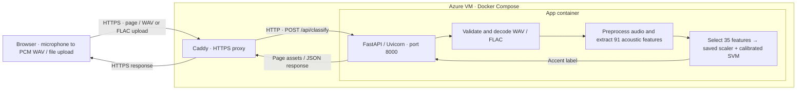

# Singapore English Accent Classification

A web demo that records microphone audio or accepts a WAV or FLAC upload and returns **Singapore Accent** or **Non-Singapore Accent** with an estimated probability, using a calibrated 35-feature RBF SVM classifier. The frontend uses HTML, CSS and JavaScript; the backend uses FastAPI.

[Open the hosted demo](https://singlish-demo-4e04e8d0.eastasia.cloudapp.azure.com/).

## Prerequisites

Python 3.12 or later is required; Python 3.14 matches the deployment environment. Dependencies are pinned in `mvp/requirements.txt`; the model manifest records the artifact's serving environment. The commands below use Bash on Linux or macOS.

The final model is `svm_35_calibrated.joblib` (35 selected inputs from the 91-feature acoustic pool). Model binaries will be provided through [GitHub release `e1-feature-study-20261019`](https://github.com/nuswohc/Singlish/releases/tag/e1-feature-study-20261019), separately from the source code.
Copy it to `mvp/models/svm_35_calibrated.joblib` and place its accompanying
`svm_35_calibrated_metadata.json` in the same directory (model binaries are ignored by Git).
Only load trusted joblib files: loading them executes Python code.

## Setup

From the repository root:

```bash
python3 -m venv mvp/.venv
mvp/.venv/bin/python -m pip install -r mvp/requirements.txt
```

## Run

From the repository root:

```bash
./mvp/run.sh
```

Open **http://127.0.0.1:8000**. The local server binds to localhost. To use a different port:

```bash
PORT=8001 ./mvp/run.sh
```

## Using the demo

- **Record:** select **Record audio**, allow microphone access, read **“They tried to keep it a secret”** slowly and clearly over 3–6 seconds, then select **Stop recording**. Recording stops automatically at 10 seconds. **Cancel** discards the new take and preserves any previously selected audio.
- **Upload:** choose or drop a PCM WAV or FLAC file.

Listen to the preview, then select **Classify recording**. The result shows the predicted accent and its probability, such as **Singapore Accent 89%**, plus recording duration. The percentage belongs to the displayed class, including Non-Singapore results. Model information is available under **Model details**.

Microphone recording requires a browser with MediaRecorder and Web Audio support, microphone permission, and HTTPS or localhost. The browser converts captured audio to mono 16-bit PCM WAV before classification. Switching tabs, backgrounding the browser or leaving the page cancels an active recording and releases the microphone. Stopping or cancelling also releases it. Audio is sent to the server only when **Classify recording** is selected; WAV and FLAC uploads remain available if recording is unsupported or permission is denied.

Use 3–6 seconds of clear English speech from one speaker. Recordings must be uncompressed PCM WAV or lossless FLAC, no larger than 10 MiB or 10 seconds. The trimmed audio must last at least three seconds. If it exceeds six seconds, only the first six seconds after trimming are classified, and a notice is shown. Mono and stereo recordings at other sample rates are supported. The server validates the file content, not just its filename.

Upload and result panels appear side by side on desktop and stack on mobile and tablet.

## System design

The hosted demo runs on an Azure VM using Docker Compose. Caddy provides HTTPS, and FastAPI serves both the web page and the classification API.



Audio is processed per request and not retained. The application does not require a database. See [Azure deployment](deploy/azure/README.md) for hosting details.

## Model behavior and limitations

The backend uses the upstream training preprocessing, with a six-second crop for longer uploads: mono → 16 kHz (soxr HQ) → 40 dB frame-RMS silence trimming (25 ms frames, 10 ms hop, 100 ms edge padding) → require at least three seconds and crop to the first six seconds if longer → reject RMS below 1e-5 → normalize to −20 dBFS RMS → limit peak to 0.99 → PCM16 quantization. It extracts the original 39 acoustic features plus 52 MFCC delta/delta-delta statistics (width 9), then selects the 35 input columns in the order recorded in the calibrated model's metadata. No padding is applied. Internal pauses are preserved. Already processed study clips are decoded directly during feature verification, without applying preprocessing again.

The saved pipeline contains the fitted scaler and classifier; no training occurs in the app.

### Swapping development models

Replace `mvp/models/svm_35_calibrated.joblib` and restart the local server. No checksum update is required. Alternatively, set `MODEL_PATH` to an absolute path or a path relative to `mvp/`:

```bash
MODEL_PATH=/path/to/another_model.joblib MODEL_VERSION=experiment-2 ./mvp/run.sh
```

`MODEL_VERSION` is optional; by default the model filename stem is reported by the API. Models must support `predict_proba` and map classes 0/1 to non-Singapore/Singapore. The loader accepts a direct estimator with `<model_stem>_metadata.json` or a study dictionary containing `model`, `columns` and `feature_names`. Selected-feature models require metadata specifying their input columns from the current 91-feature pool, in the exact training order. A direct estimator using all 91 features can omit the sidecar. When swapping a selected-feature model, replace both the binary and its metadata together. No checksum is required. New feature definitions or different preprocessing require code changes. To package a different file for Azure later, put it in `mvp/models/` and change `model_file` in the manifest; its metadata sidecar is included automatically. Azure updates require a container rebuild.

The calibrated model uses sigmoid calibration. Singapore is predicted when its probability is at least 0.5; otherwise Non-Singapore is predicted. `prediction.probability` is the estimated probability of the displayed class, expressed from 0 to 1 in the API and rounded to a whole percentage in the UI. It is not a measured accuracy for the individual recording.

The classifier assesses accent characteristics, not nationality or identity, and results may be incorrect. It cannot confirm that a recording contains English speech, check whether the displayed sentence was spoken, or reliably reject noise and music. The current MVP does not provide transcription, speech detection or audio quality scoring.

## API

- `GET /` — recording and upload page.
- `GET /api/health` — readiness and model version.
- `POST /api/classify` — multipart form containing exactly one `audio` file.

Example using a local WAV file:

```bash
curl -F 'audio=@recording.wav' http://127.0.0.1:8000/api/classify
```

Success returns `prediction` (`class_id`, `label`, `display_label`, `probability`), `audio` (`duration_seconds`, `classified_duration_seconds`, `truncated`), `warnings`, and `model_version`. Classified duration refers to the signal after boundary trimming and optional six-second cropping, not verified speech duration. `truncated` is true when a six-second crop was applied, and `warnings` explains that only the first six seconds were classified.

Errors return `error.code` and `error.message`: 413 for size limits, 415 for unsupported formats or encodings, 422 for invalid requests/audio or excessive duration, and 500 for unexpected inference failure.

## Verification

```bash
mvp/.venv/bin/python -m pytest mvp/tests -q
node --test mvp/tests/test_ui.cjs mvp/tests/test_recorder.cjs
# Offline research-data verification only; pyarrow is not needed by the server.
mvp/.venv/bin/python -m pip install pyarrow==26.0.0
mvp/.venv/bin/python -m mvp.scripts.verify_study /path/to/E1_Feature_Engineering --output mvp/verification.json
```
