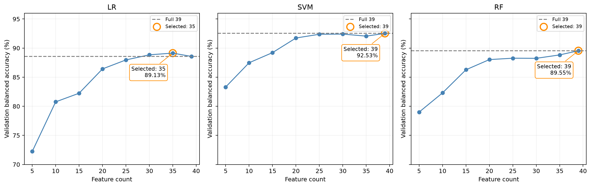
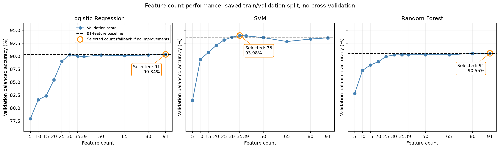
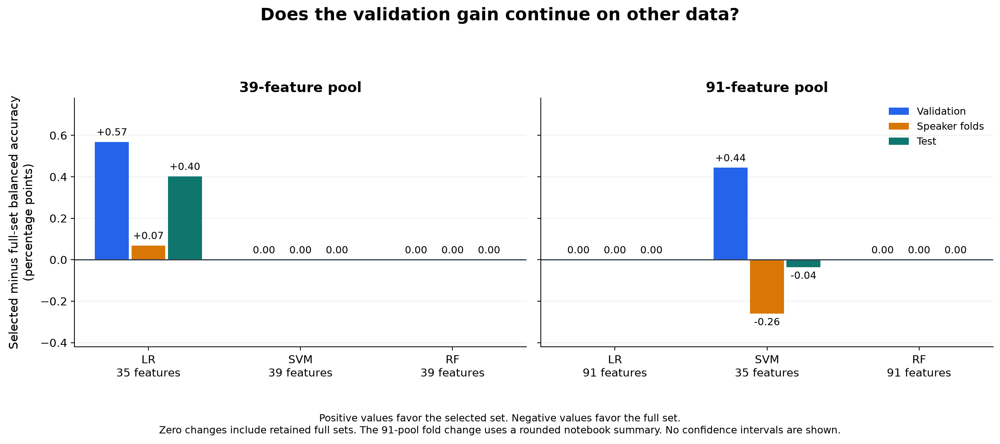
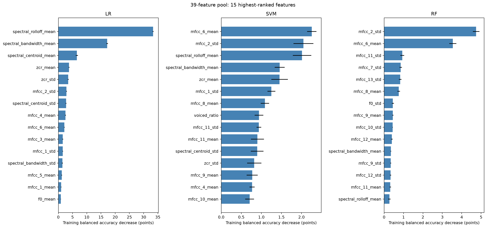
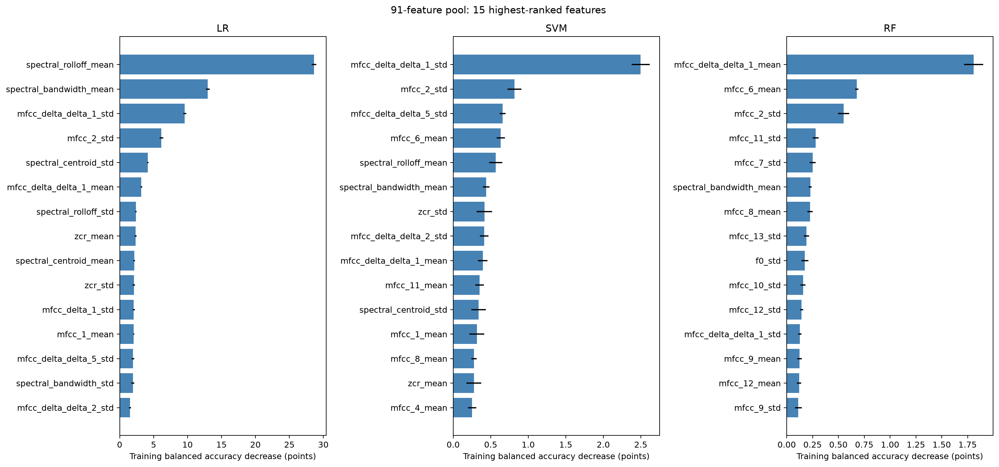
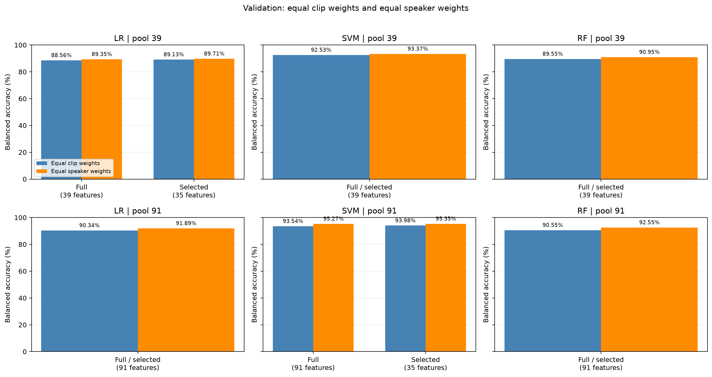

# E1 feature selection and model comparison

Date: 18 October 2026

## 1. Goal and Method

This experiment is to establish the supervised ML baseline and select one best model as classifier.

It uses the acoustic features such as MFCCs and pitch, train and compare Support Vector Machine (SVM), Random Forest (RF) and Logistic Regression (LR) on labelled speech.

The experiments conducted in the following sequence:

1. Compare the classifiers with all available acoustic features.
2. Compare tested feature counts and identify best feature count for each classifier.
3. Examine feature importance and feature selection in each speaker fold.
4. Check whether equal speaker weights change the validation result.
5. Combine the evidence for each classifier and select one model.

## 2. Data and feature pools

| Split | Non-Singapore clips | Singapore clips | Non-Singapore speakers | Singapore speakers |
| --- | --- | --- | --- | --- |
| Training | 4,519 | 3,489 | 2,507 | 727 |
| Validation | 987 | 755 | 537 | 150 |
| Test | 980 | 756 | 529 | 155 |
| Total | 6,486 | 5,000 | 3,573 | 1,032 |

There are **11,486 clips** and a further **554 Common Voice Singaporean clips** (not listed in the table) reserved for an out-of-domain (OOD) check and are excluded from every main split

We break the features into two pool:
  1. 39-feature: Contain 39 features that describe the sound spectrum.
  2. 91-feature: It extends the 39-features with additional delta features (measure changes between frames) and delta-delta features (measure changes in those delta values). Total 91 features.

| Feature block | 39-feature pool | 91-feature pool |
| --- | --- | --- |
| MFCC means and standard deviations | 26 | 26 |
| Pitch and estimated voicing | 3 | 3 |
| Spectral means and standard deviations | 6 | 6 |
| Zero-crossing-rate means and standard deviations | 2 | 2 |
| RMS energy means and standard deviations | 2 | 2 |
| MFCC delta means and standard deviations | 0 | 26 |
| MFCC delta-delta means and standard deviations | 0 | 26 |
| Total | 39 | 91 |

Classifier settings stay fixed during the feature count comparisons. Thus, the comparisons show the effect of feature selection under those settings.

## 3. Testing results with all acoustic features

| Classifier | Feature pool | Validation balanced accuracy | Combined fold score | Test balanced accuracy | Test macro-F1 |
| --- | --- | --- | --- | --- | --- |
| LR | 39 | 88.56% | 88.69% | 88.58% | 0.8816 |
| LR | 91 | 90.34% | 91.91% | 91.81% | 0.9135 |
| SVM | 39 | 92.53% | 92.92% | 93.13% | 0.9279 |
| SVM | 91 | 93.54% | 94.36% | 94.44% | 0.9412 |
| RF | 39 | 89.55% | 89.82% | 89.78% | 0.8957 |
| RF | 91 | 90.55% | 91.57% | 91.86% | 0.9156 |

All three classifiers improve on validation, combined folds, and test data when they use the full 91-feature pool. The added features supply useful information under these fixed classifier settings.

SVM has the highest scores in both full pools. Its test balanced accuracy increases from **93.13% to 94.44%**. Its combined fold score increases from **92.92% to 94.36%**. LR and RF also improve, but their absolute scores remain below SVM.

**Conclusion:** All 91 features improve validation, fold, and test scores for each classifier. SVM gives the highest accuracy in both full feature pools.

## 4. Impact of reducing feature count

### Testing with the 39-feature pool

Rules: The tested feature counts are 5, 10, 15, 20, 25, 30, 35, and 39. Select the highest validation score that strictly exceeds the full-set baseline. An exact tie selects fewer features. If no count improves the baseline, retain 39.

Figure 1. Validation scores for the original 39-feature pool. Orange circles show selected counts. Dashed lines show full-pool scores.

| Classifier | Best tested count | Best validation score | Selected count | Selected validation score | Inputs removed |
| --- | --- | --- | --- | --- | --- |
| LR | 35 | 89.13% | 35 | 89.13% | 10.3% |
| SVM | 39 | 92.53% | 39 | 92.53% | 0.0% |
| RF | 39 | 89.55% | 39 | 89.55% | 0.0% |

LR selects 35 features. Its validation score increases from **88.56% to 89.13%**. SVM and RF keep all 39 features because no smaller tested count improves their full-model validation scores.

**Conclusion:** LR can use 35 original features with small measured score increases. SVM and RF keep all 39 features under the selection rule.

### Testing with the larger 91-feature pool

Rules: The tested counts are 5, 10, 15, 20, 25, 30, 35, 39, 50, 65, 80, and 91. Select the highest validation balanced accuracy that strictly exceeds the full 91-feature baseline. An exact score tie selects fewer features. If no count improves the baseline, retain 91.

Figure 2. Validation scores for the 91-feature pool. Orange circles show selected counts. Each callout shows the selected count and its validation balanced accuracy. Dashed lines show full-pool scores.

| Classifier | Best tested count | Best validation score | Selected count | Selected validation score | Inputs removed |
| --- | --- | --- | --- | --- | --- |
| LR | 91 | 90.34% | 91 | 90.34% | 0.0% |
| SVM | 35 | 93.98% | 35 | 93.98% | 61.5% |
| RF | 91 | 90.55% | 91 | 90.55% | 0.0% |

LR and RF retain all 91 features because no smaller tested count improves their full-model validation scores. SVM selects 35 features. Its validation balanced accuracy increases from **93.54% to 93.98%**.

The table below compares each selected model with its own full 91-feature model. All score changes are in percentage points. Fold changes use the values displayed in the completed notebook.

| Classifier | Selected count | Validation change | Fold change | Test change |
| --- | --- | --- | --- | --- |
| LR | 91 | +0.00 | +0.00 | +0.00 |
| SVM | 35 | +0.44 | -0.26 | -0.04 |
| RF | 91 | +0.00 | +0.00 | +0.00 |

The 35-feature SVM removes 56 inputs, or **61.5%**. Its combined fold score is **94.10%**, compared with **94.36%** for all 91 features. It matches or exceeds the full-model score in only **1 of 3 folds**. Its test balanced accuracy is **94.40%**, compared with **94.44%** for all 91 features.

The fold check keeps the selected count fixed. Validation speakers already helped select that count, so this check is exploratory. It does not independently evaluate the complete selection procedure.

The study did not measure processing time savings. The delta extractor still calculates MFCC frames. A reduction in feature count does not establish an equal reduction in processing time.

**Conclusion:** The updated rule selects a 35-feature SVM and retains all 91 features for LR and RF. The smaller SVM improves validation accuracy, but its fold and test scores are slightly lower than the full model. These results do not establish an accuracy improvement on new data.

### Does the validation gain continue in speaker folds and test data?

Figure 3 compares each selected feature count with its own full-pool baseline.
Positive values show a gain in balanced accuracy. Negative values show a loss. A zero change for a retained full set means the same model is used.

**Figure 3. Effect of feature reduction across evaluation stages.** Values are percentage-point changes.

LR with 35 of the original 39 features keeps small gains on validation, folds, and test data: **+0.57**, **+0.07**, and **+0.40** points. SVM with 35 of 91 features gains **+0.44** points on validation, but loses **0.26** points on folds and **0.04** points on test data. All other selected counts retain their full feature pools.

**Conclusion:** The 39-feature LR gain continues across all three stages. The 91-feature SVM validation gain does not continue in folds or test data.

## 5. Feature importance and selection agreement

The feature-importance test ranks features by training permutation importance. It shuffles one feature at a time between training clips and measures the decrease in balanced accuracy. A larger decrease shows greater model reliance on that feature. Each feature is shuffled five times. Error bars show variation across those five repeats.

Figure 4. The 15 highest-ranked training features in the original pool.

Figure 5. The 15 highest-ranked training features in the 91-feature pool.

All features displayed in Figures 4 and 5 belong to the selected sets in the training rankings.

| Pool | Classifier | Three highest training-ranked features | Selected count |
| --- | --- | --- | --- |
| 39 | LR | `spectral_rolloff_mean`, `spectral_bandwidth_mean`, `spectral_centroid_mean` | 35 |
| 39 | SVM | `mfcc_6_mean`, `mfcc_2_std`, `spectral_rolloff_mean` | 39 |
| 39 | RF | `mfcc_2_std`, `mfcc_6_mean`, `mfcc_11_std` | 39 |
| 91 | LR | `spectral_rolloff_mean`, `spectral_bandwidth_mean`, `mfcc_delta_delta_1_std` | 30 |
| 91 | SVM | `mfcc_delta_delta_1_std`, `mfcc_2_std`, `mfcc_delta_delta_5_std` | 25 |
| 91 | RF | `mfcc_delta_delta_1_mean`, `mfcc_6_mean`, `mfcc_2_std` | 25 |

LR gives high importance to spectral measurements in both pools. The 91-feature LR also uses delta-delta measurements. The original-pool SVM and RF give high importance to MFCC measurements. The 91-feature SVM and RF also give high importance to delta-delta measurements.

The final models use a new feature ranking from training and validation data together. Their selected features can differ from the training ranking and the fold rankings.

| Pool | Classifier | 39-features | Delta | Delta-delta | Total |
| --- | --- | --- | --- | --- | --- |
| 39 | LR | 35 | 0 | 0 | 35 |
| 39 | SVM | 39 | 0 | 0 | 39 |
| 39 | RF | 39 | 0 | 0 | 39 |
| 91 | LR | 21 | 3 | 6 | 30 |
| 91 | SVM | 19 | 1 | 5 | 25 |
| 91 | RF | 19 | 2 | 4 | 25 |

All selected 91-pool models keep features that measure change with time. Appendix A gives the feature names in the saved order.

**Conclusion:** Spectral, MFCC, and time-change measurements supply useful model inputs. Feature importance guides selection, but it does not establish that fewer features improve accuracy.

## 6. Impact of speaker weights

Equal clip weights give each clip equal influence within its class. Equal speaker weights give each speaker equal total influence: each clip receives weight `1 / number of clips from its speaker`. Both methods balance the two classes. Models, predictions, and selected counts stay fixed.

**Figure 6. Validation balanced accuracy with clip and speaker weights.**

**Figure 6b. Test balanced accuracy with clip and speaker weights.**

Speaker weighting raises every reported score. The 35-feature SVM leads on validation under both methods. With speaker weights, it scores **95.35%**, compared with **95.27%** for full 91. On test data, full 91 scores slightly higher: **95.56%** versus **95.53%**.

**Conclusion:** Speaker weighting preserves the main finding: the 35-feature SVM has a small validation advantage, but full 91 has a slightly higher test score. It does not change the selected counts or make repeated clips independent.

## 7. Combined assessment for each classifier

| Classifier | 39 vs 91 features | Feature reduction | Feature importance | Speaker weighting | Decision |
| --- | --- | --- | --- | --- | --- |
| LR | 91 improves validation, fold, and test scores. | Select 35 from 39; retain all 91. | Spectral measurements rank highly; 91 adds delta-delta inputs. | Raises scores; full 91 remains best for LR. | Use 35 for fewer inputs; 91 for higher LR accuracy. |
| SVM | 91 improves all scores. SVM leads both pools. | Keep all 39. Select 35 from 91: higher validation, slightly lower fold and test scores. | MFCC and delta-delta measurements rank highly. | Raises scores; 35 keeps a small validation gain over 91. | **Select SVM with 35 features.** Full 91 has slightly higher fold and test scores. |
| RF | 91 improves validation, fold, and test scores. | Keep all 39 and all 91; smaller counts do not improve validation. | MFCC and delta-delta measurements rank highly. | Raises scores; full 91 remains best for RF. | Retain 91 as the RF reference; prefer SVM overall. |

## 8. Final model choice and test assessment

**Selected model: RBF SVM with 35 features from the 91-feature pool.** It has the highest validation balanced accuracy, **93.98%**, and strictly exceeds the full 91-feature baseline of **93.54%**.

The selected SVM uses **61.5% fewer inputs** than the full 91-feature model. Its test balanced accuracy is **94.40%** and its test macro-F1 is **0.9406**. Its test balanced accuracy is **1.27 percentage points** above the original 39-feature SVM.

| SVM Model | Features | Validation balanced accuracy | Combined fold score | Test balanced accuracy | Test macro-F1 |
| --- | --- | --- | --- | --- | --- |
| Final model  | 35 | 93.98% | 94.10% | 94.40% | 0.9406 |
| Best 91-features | 91 | 93.54% | 94.36% | 94.44% | 0.9412 |
| Best 39-features | 39 | 92.53% | 92.92% | 93.13% | 0.9279 |

The final model is fitted on training and validation data together. It applies standard scaling before classification. The SVM settings are `SVC(kernel='rbf', C=1.0, gamma='scale', class_weight='balanced', random_state=42)`.

This model uses the default SVM decision rule.

Model binaries for this snapshot will be published as assets on [GitHub release `e1-feature-study-20261019`](https://github.com/nuswohc/Singlish/releases/tag/e1-feature-study-20261019), separately from the report and notebooks. Planned release assets:

- Selected model (35 features from the 91-feature pool): `svm_35.joblib`.
- 39-feature reference: `svm_39.joblib`.
- 91-feature reference: `svm_91.joblib`.

Use the release associated with the 19 October 2026 snapshot; artifact filenames may also appear in earlier releases.

### 8.1. Probability calibration: additional test

Calibration adds a Singapore probability to each SVM output. The original SVM uses a decision-score boundary of zero. The calibrated model predicts Singapore when its probability is at least **0.50**. This probability boundary can change the predicted class.

Sigmoid calibration uses held-out scores from five speaker-separated folds of training and validation data. Feature columns stay fixed, and the final SVM decision scores match the originals. Test clips do not enter fitting or calibration. Separate calibrated files preserve the original models.

The table compares both decision rules on the same **1,736 test clips**. SG means Singapore.

| SVM features | Decision rule | Test balanced accuracy | SG recall | Non-SG false-positive rate | False positives | False negatives |
| --- | --- | --- | --- | --- | --- | --- |
| 35 | Original SVM | 94.40% | 96.56% | 7.76% | 76 | 26 |
| 35 | Calibrated, threshold 0.50 | 94.71% | 95.24% | 5.82% | 57 | 36 |
| 91 | Original SVM | 94.44% | 96.43% | 7.55% | 74 | 27 |
| 91 | Calibrated, threshold 0.50 | 94.69% | 94.58% | 5.20% | 51 | 41 |

For the 35-feature SVM, calibration prevents **19 false positives**, adds **10 missed Singapore clips**, and raises balanced accuracy by **0.31 percentage points**. For the 91-feature SVM, it prevents **23 false positives** and adds **14 missed Singapore clips**.

These are exploratory results. The 35-feature selection used development data, and the test set was examined in earlier experiments. The scores do not establish an improvement on new data or reliable probabilities for OOD clips.

The [calibration notebook](E1_svm_35_91_calibrated_probability.ipynb) exports `svm_35_calibrated.joblib` and `svm_91_calibrated.joblib`. These calibrated models will be included in the same snapshot release on [GitHub release `e1-feature-study-20261019`](https://github.com/nuswohc/Singlish/releases/tag/e1-feature-study-20261019). Each file supports class predictions and class probabilities.

**Conclusion:** For the 35-feature SVM, calibration at the 0.50 threshold reduces false positives from **76 to 57**, while increasing false negatives (Singapore clips classified as Non-Singapore) from **26 to 36**.

## Appendix A. Final saved feature lists

These lists show the feature order in the final saved selected models. The final ranking uses training and validation data together. It can differ from the training ranking. Full models keep the feature order in their corresponding caches.

### 39-feature pool

**LR: 35 features.**

`spectral_rolloff_mean`, `spectral_bandwidth_mean`, `spectral_centroid_mean`, `zcr_mean`, `zcr_std`, `mfcc_4_mean`, `spectral_centroid_std`, `mfcc_2_std`, `mfcc_6_mean`, `mfcc_3_mean`, `mfcc_1_std`, `spectral_bandwidth_std`, `mfcc_5_mean`, `mfcc_11_mean`, `mfcc_1_mean`, `mfcc_7_mean`, `f0_mean`, `mfcc_12_std`, `mfcc_6_std`, `mfcc_5_std`, `mfcc_11_std`, `mfcc_2_mean`, `mfcc_9_mean`, `mfcc_3_std`, `mfcc_8_mean`, `rms_mean`, `mfcc_8_std`, `mfcc_13_std`, `f0_std`, `spectral_rolloff_std`, `mfcc_7_std`, `mfcc_10_std`, `mfcc_12_mean`, `mfcc_10_mean`, `mfcc_9_std`.

Feature counts: original 35, delta 0, delta-delta 0.

**SVM: 39 features.**

`mfcc_1_mean`, `mfcc_2_mean`, `mfcc_3_mean`, `mfcc_4_mean`, `mfcc_5_mean`, `mfcc_6_mean`, `mfcc_7_mean`, `mfcc_8_mean`, `mfcc_9_mean`, `mfcc_10_mean`, `mfcc_11_mean`, `mfcc_12_mean`, `mfcc_13_mean`, `mfcc_1_std`, `mfcc_2_std`, `mfcc_3_std`, `mfcc_4_std`, `mfcc_5_std`, `mfcc_6_std`, `mfcc_7_std`, `mfcc_8_std`, `mfcc_9_std`, `mfcc_10_std`, `mfcc_11_std`, `mfcc_12_std`, `mfcc_13_std`, `f0_mean`, `f0_std`, `voiced_ratio`, `spectral_centroid_mean`, `spectral_centroid_std`, `spectral_bandwidth_mean`, `spectral_bandwidth_std`, `spectral_rolloff_mean`, `spectral_rolloff_std`, `zcr_mean`, `zcr_std`, `rms_mean`, `rms_std`.

Feature counts: original 39, delta 0, delta-delta 0.

**RF: 39 features.**

`mfcc_1_mean`, `mfcc_2_mean`, `mfcc_3_mean`, `mfcc_4_mean`, `mfcc_5_mean`, `mfcc_6_mean`, `mfcc_7_mean`, `mfcc_8_mean`, `mfcc_9_mean`, `mfcc_10_mean`, `mfcc_11_mean`, `mfcc_12_mean`, `mfcc_13_mean`, `mfcc_1_std`, `mfcc_2_std`, `mfcc_3_std`, `mfcc_4_std`, `mfcc_5_std`, `mfcc_6_std`, `mfcc_7_std`, `mfcc_8_std`, `mfcc_9_std`, `mfcc_10_std`, `mfcc_11_std`, `mfcc_12_std`, `mfcc_13_std`, `f0_mean`, `f0_std`, `voiced_ratio`, `spectral_centroid_mean`, `spectral_centroid_std`, `spectral_bandwidth_mean`, `spectral_bandwidth_std`, `spectral_rolloff_mean`, `spectral_rolloff_std`, `zcr_mean`, `zcr_std`, `rms_mean`, `rms_std`.

Feature counts: original 39, delta 0, delta-delta 0.

### 91-feature pool

**LR: 30 features.**

`spectral_rolloff_mean`, `spectral_bandwidth_mean`, `mfcc_delta_delta_1_std`, `mfcc_2_std`, `spectral_centroid_mean`, `zcr_mean`, `spectral_centroid_std`, `mfcc_delta_delta_1_mean`, `spectral_rolloff_std`, `zcr_std`, `spectral_bandwidth_std`, `mfcc_delta_delta_5_std`, `mfcc_delta_1_std`, `mfcc_4_mean`, `mfcc_1_mean`, `mfcc_delta_delta_2_std`, `mfcc_3_mean`, `mfcc_6_mean`, `rms_mean`, `mfcc_8_std`, `mfcc_delta_5_std`, `mfcc_2_mean`, `mfcc_5_std`, `mfcc_12_std`, `mfcc_delta_1_mean`, `mfcc_delta_delta_7_std`, `f0_mean`, `mfcc_11_mean`, `mfcc_delta_delta_13_std`, `mfcc_3_std`.

Feature counts: original 21, delta 3, delta-delta 6.

**SVM: 25 features.**

`mfcc_delta_delta_1_std`, `mfcc_6_mean`, `mfcc_2_std`, `spectral_rolloff_mean`, `mfcc_delta_delta_5_std`, `zcr_mean`, `zcr_std`, `mfcc_11_mean`, `mfcc_4_mean`, `mfcc_delta_delta_1_mean`, `mfcc_8_mean`, `spectral_bandwidth_mean`, `mfcc_1_mean`, `spectral_centroid_std`, `mfcc_delta_delta_2_std`, `rms_mean`, `mfcc_9_mean`, `mfcc_10_mean`, `spectral_centroid_mean`, `mfcc_delta_delta_4_std`, `mfcc_13_mean`, `rms_std`, `mfcc_delta_4_std`, `mfcc_4_std`, `mfcc_11_std`.

Feature counts: original 19, delta 1, delta-delta 5.

**RF: 25 features.**

`mfcc_delta_delta_1_mean`, `mfcc_6_mean`, `mfcc_2_std`, `mfcc_11_std`, `mfcc_7_std`, `mfcc_13_std`, `mfcc_8_mean`, `mfcc_12_std`, `f0_std`, `spectral_bandwidth_mean`, `mfcc_delta_2_mean`, `mfcc_12_mean`, `mfcc_delta_delta_1_std`, `mfcc_delta_delta_2_mean`, `mfcc_10_std`, `mfcc_9_std`, `mfcc_11_mean`, `mfcc_10_mean`, `spectral_rolloff_mean`, `mfcc_8_std`, `mfcc_delta_delta_5_std`, `mfcc_9_mean`, `mfcc_delta_1_mean`, `mfcc_4_mean`, `voiced_ratio`.

Feature counts: original 19, delta 2, delta-delta 4.
