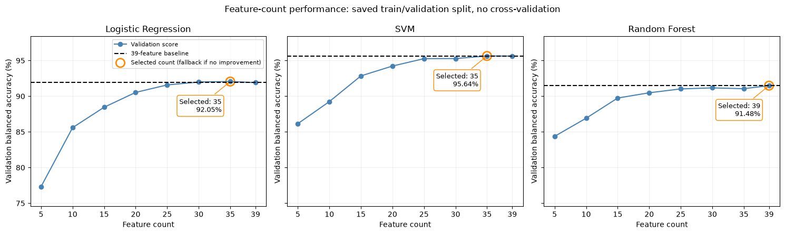
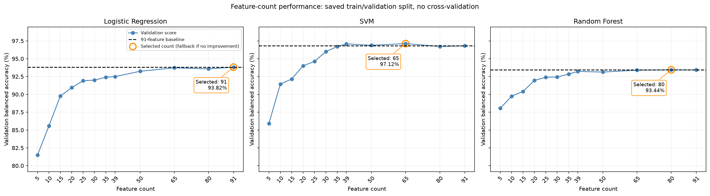
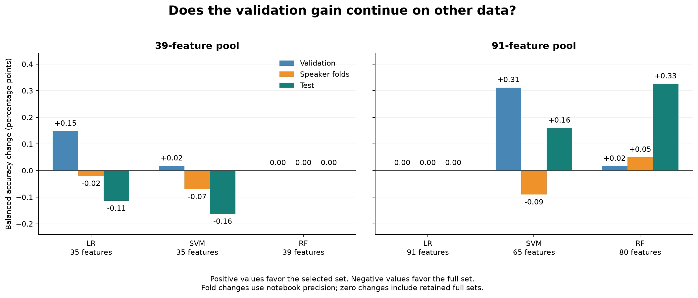
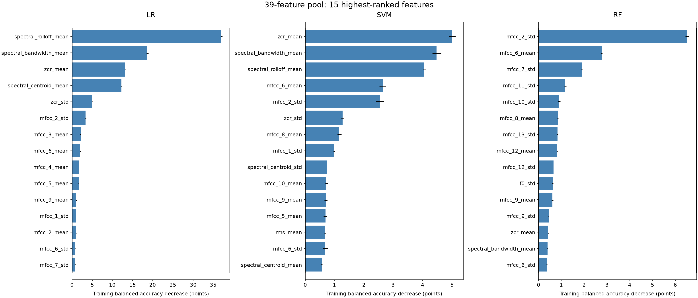
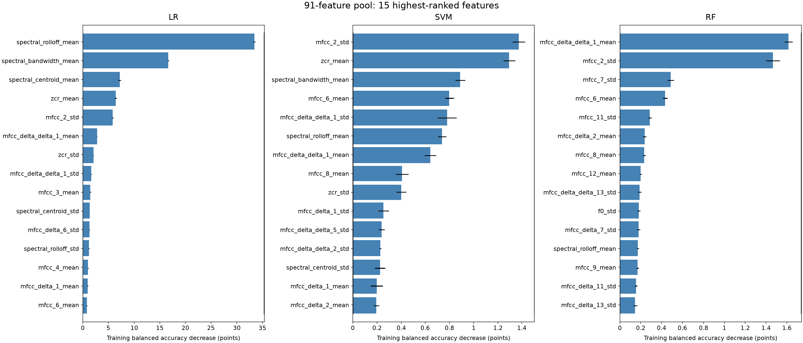
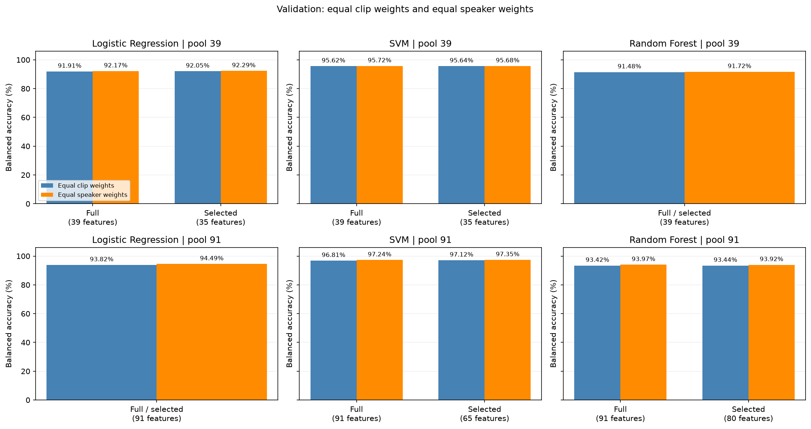
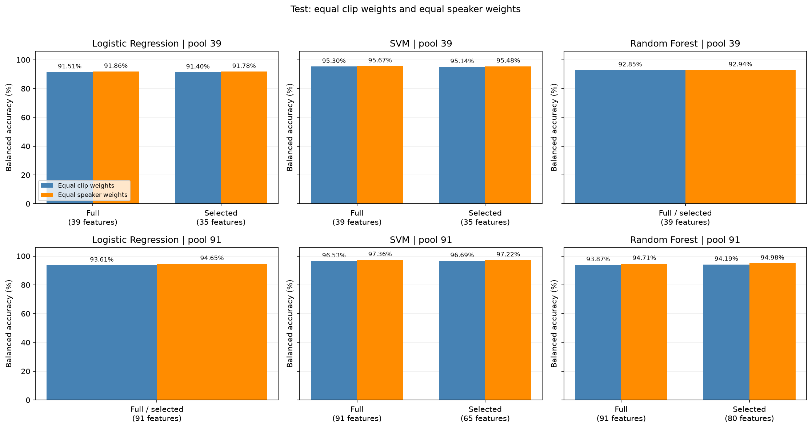

# E1 feature selection and model comparison

Date: 24 October 2026

## 1. Goal and Method

Compare Logistic Regression (LR), Support Vector Machine (SVM), and Random Forest (RF) to select an acoustic classifier for Singapore and Non-Singapore speech.

The study compares full feature pools, selects feature counts using validation balanced accuracy, checks the selected counts on three speaker-separated development folds, and evaluates final models on test data. Classifier settings stay fixed during feature-count comparisons.

## 2. Data and feature pools

| Split | Non-Singapore clips | Singapore clips | Non-Singapore speakers | Singapore speakers |
| --- | --- | --- | --- | --- |
| Training | 13,848 | 13,949 | 5,960 | 979 |
| Validation | 3,067 | 3,017 | 1,300 | 204 |
| Test | 3,085 | 3,034 | 1,267 | 215 |
| Total | 20,000 | 20,000 | 8,527 | 1,398 |

There are **40,000 clips** from **9,925 speakers**, with no speakers shared between splits. Singapore clips come from MNSC: 7,500 PART1 and 12,500 PART2 clips. Non-Singapore clips come from Common Voice (18,871), Speech Accent Archive (329), and speechocean762 (800). Feature extraction reports no exclusions.

The **39-feature pool** contains MFCC, pitch/voicing, spectral, zero-crossing-rate, and energy statistics. The **91-feature pool** adds 26 MFCC delta and 26 delta-delta statistics. Audio is preprocessed upstream; extraction decodes the 16 kHz, mono, 3–6-second clips without further waveform changes.

| Feature block | 39-feature pool | 91-feature pool |
| --- | --- | --- |
| MFCC means and standard deviations | 26 | 26 |
| Pitch and estimated voicing | 3 | 3 |
| Spectral means and standard deviations | 6 | 6 |
| Zero-crossing-rate means and standard deviations | 2 | 2 |
| RMS energy means and standard deviations | 2 | 2 |
| MFCC delta means and standard deviations | 0 | 26 |
| MFCC delta-delta means and standard deviations | 0 | 26 |
| Total | 39 | 91 |

## 3. Testing results with all acoustic features

All accuracy scores below are balanced accuracy. The combined fold score pools held-out predictions from three development folds.

| Classifier | Features | Validation | Combined folds | Test | Test macro-F1 |
| --- | --- | --- | --- | --- | --- |
| LR | 39 | 91.91% | 91.74% | 91.51% | 0.9150 |
| LR | 91 | 93.82% | 94.36% | 93.61% | 0.9359 |
| SVM | 39 | 95.62% | 95.50% | 95.30% | 0.9529 |
| SVM | 91 | 96.81% | 96.70% | 96.53% | 0.9652 |
| RF | 39 | 91.48% | 92.60% | 92.85% | 0.9284 |
| RF | 91 | 93.42% | 94.44% | 93.87% | 0.9385 |

All three classifiers improve across validation, folds, and test data with the 91-feature pool. SVM leads in both pools.

## 4. Impact of reducing feature count

Select the tested count with the highest validation score that strictly exceeds its full-pool baseline. Exact ties prefer fewer features; if no count improves the baseline, retain the full pool. In this run, each selected count is also its classifier’s best tested validation count within that pool.

### Testing with the 39-feature pool

The tested counts are 5, 10, 15, 20, 25, 30, 35, and 39.

**Figure 1.** Validation balanced accuracy by feature count. Orange circles mark selected counts; dashed lines show full-pool baselines.

| Classifier | Selected count | Selected validation | Selected folds | Selected test | Inputs removed |
| --- | --- | --- | --- | --- | --- |
| LR | 35 | 92.05% | 91.71% | 91.40% | 10.3% |
| SVM | 35 | 95.64% | 95.43% | 95.14% | 10.3% |
| RF | 39 | 91.48% | 92.60% | 92.85% | 0.0% |

LR and SVM gain slightly on validation with 35 features, but their fold and test scores decrease. RF retains all 39 features.

### Testing with the larger 91-feature pool

This study also tests 50, 65, 80, and 91 features.

**Figure 2.** Validation balanced accuracy by feature count. The selected counts are 91 for LR, 65 for SVM, and 80 for RF.

| Classifier | Selected count | Selected validation | Selected folds | Selected test | Inputs removed |
| --- | --- | --- | --- | --- | --- |
| LR | 91 | 93.82% | 94.36% | 93.61% | 0.0% |
| SVM | 65 | 97.12% | 96.61% | 96.69% | 28.6% |
| RF | 80 | 93.44% | 94.49% | 94.19% | 12.1% |

The **65-feature SVM** gains **0.31 percentage points** on validation and **0.16 points** on test data against the full 91-feature SVM. RF with 80 features has small gains across all three stages; LR retains all 91.

The selected models compare with their own full-pool baselines as follows. All changes are in percentage points.

| Pool | Classifier | Selected count | Validation change | Fold change | Test change |
| --- | --- | --- | --- | --- | --- |
| 39 | LR | 35 | +0.15 | -0.02 | -0.11 |
| 39 | SVM | 35 | +0.02 | -0.07 | -0.16 |
| 39 | RF | 39 | +0.00 | +0.00 | +0.00 |
| 91 | LR | 91 | +0.00 | +0.00 | +0.00 |
| 91 | SVM | 65 | +0.31 | -0.09 | +0.16 |
| 91 | RF | 80 | +0.02 | +0.05 | +0.33 |

Fold changes use the notebook’s directly reported differences; subtracting rounded absolute fold scores can give a slightly different result.

### Does the validation gain continue in speaker folds and test data?

**Figure 3.** Selected-minus-full changes in balanced accuracy, in percentage points. Positive values show gains; zero for a retained full set means the same model is used. Fold changes use the notebook's reported precision.

The 39-pool LR and SVM validation gains do not continue in folds or test data. The 65-feature SVM's combined fold score is **0.09 points lower** than full 91, and it falls below the full model in all three folds, despite its validation and test gains. The 80-feature RF has small gains at all three stages.

The fold check is exploratory because development labels already helped select the counts. Fewer model inputs do not imply an equal reduction in feature-extraction time.

## 5. Feature importance and selection agreement

Features are ranked by the decrease in training balanced accuracy when each feature is shuffled, using five repeats. Rankings are refitted within each speaker fold and again on training plus validation data for the final models.

**Figure 4.** The 15 highest-ranked training features for each classifier in the 39-feature pool. LR, SVM, and RF are shown side by side. Bars and error bars come from the saved notebook chart; error bars show variation across five shuffles. [View the original full-ranking chart](./figures/originals/training_feature_importance_39_full.png).

**Figure 5.** The 15 highest-ranked training features for each classifier in the 91-feature pool. LR, SVM, and RF are shown side by side. Each horizontal axis begins at zero; the numerical scales differ between classifiers. All features shown in Figures 4 and 5 belong to their training-selected sets. [View the original full-ranking chart](./figures/originals/training_feature_importance_91_full.png).

| Pool | Classifier | Three highest training-ranked features | Selected count |
| --- | --- | --- | --- |
| 39 | LR | `spectral_rolloff_mean`, `spectral_bandwidth_mean`, `zcr_mean` | 35 |
| 39 | SVM | `zcr_mean`, `spectral_bandwidth_mean`, `spectral_rolloff_mean` | 35 |
| 39 | RF | `mfcc_2_std`, `mfcc_6_mean`, `mfcc_7_std` | 39 |
| 91 | LR | `spectral_rolloff_mean`, `spectral_bandwidth_mean`, `spectral_centroid_mean` | 91 |
| 91 | SVM | `mfcc_2_std`, `zcr_mean`, `spectral_bandwidth_mean` | 65 |
| 91 | RF | `mfcc_delta_delta_1_mean`, `mfcc_2_std`, `mfcc_7_std` | 80 |

LR ranks spectral measurements highly. SVM uses zero-crossing, spectral, and MFCC measurements; RF ranks MFCC measurements highly, including a delta-delta feature in the larger pool.

Final rankings are refitted on training plus validation data and can differ from the training rankings shown above. The saved selected models contain:

| Pool | Classifier | Base features | Delta | Delta-delta | Total |
| --- | --- | --- | --- | --- | --- |
| 39 | LR | 35 | 0 | 0 | 35 |
| 39 | SVM | 35 | 0 | 0 | 35 |
| 39 | RF | 39 | 0 | 0 | 39 |
| 91 | LR | 39 | 26 | 26 | 91 |
| 91 | SVM | 31 | 19 | 15 | 65 |
| 91 | RF | 39 | 25 | 16 | 80 |

The final 65-feature SVM keeps **31 base features, 19 delta features, and 15 delta-delta features**. Appendix A lists every selected model’s feature names in saved order.

Its mean feature-set agreement across folds (Jaccard similarity) is **0.7815**. The 80-feature RF has agreement of **0.8472**. These values describe selection stability; they do not establish an accuracy improvement.

## 6. Impact of speaker weights

Clip weighting gives each clip equal influence within its class. Speaker weighting gives each speaker equal total influence within its class, using `1 / clips from that speaker` per clip. Both methods balance the classes; models and predictions stay fixed.

**Figure 6.** Validation scores with equal clip weights and equal speaker weights, for both pools and all classifiers.

**Figure 6b.** Test scores with equal clip weights and equal speaker weights. The SVM comparison is summarised below.

| SVM model | Validation, clip weights | Validation, speaker weights | Test, clip weights | Test, speaker weights |
| --- | --- | --- | --- | --- |
| Full 91 | 96.81% | 97.24% | 96.53% | 97.36% |
| Selected 65 | 97.12% | 97.35% | 96.69% | 97.22% |

Speaker weighting raises all reported model scores. The 65-feature SVM retains its validation lead, but the full 91-feature SVM scores slightly higher on the speaker-weighted test measure. The preferred SVM therefore depends on the evaluation measure; the feature-count choice remains based on ordinary validation balanced accuracy.

## 7. Combined assessment for each classifier

| Classifier | 39 vs 91 features | Feature reduction | Feature importance | Speaker weighting | Decision |
| --- | --- | --- | --- | --- | --- |
| LR | 91 improves validation, folds, and test. | Select 35 from 39; retain all 91. | Spectral measurements lead. | Raises scores; full 91 remains best for LR. | Retain 91 as the LR reference. |
| SVM | 91 improves all three stages; SVM leads both pools. | Select 35 from 39 and 65 from 91. | Zero-crossing, spectral, and MFCC measurements rank highly. | 65 leads validation; full 91 leads speaker-weighted test. | **Select SVM with 65 features.** Full 91 has a slightly higher fold score. |
| RF | 91 improves all three stages. | Retain 39; select 80 from 91, with small gains at all stages. | MFCC and delta-delta measurements lead. | Raises scores; 80 loses its small validation edge but keeps its test edge over full 91. | Retain 80 as the RF reference; prefer SVM overall. |

## 8. Final model choice and test assessment

**Selected model: RBF SVM with 65 features from the 91-feature pool.** It achieves **97.12% validation balanced accuracy**, **96.69% test balanced accuracy**, and **0.9668 test macro-F1**, using 28.6% fewer inputs than the full pool.

| SVM model | Features | Validation | Combined folds | Test | Test macro-F1 |
| --- | --- | --- | --- | --- | --- |
| Selected from 91 | 65 | 97.12% | 96.61% | 96.69% | 0.9668 |
| Full 91 reference | 91 | 96.81% | 96.70% | 96.53% | 0.9652 |
| Full 39 reference | 39 | 95.62% | 95.50% | 95.30% | 0.9529 |

The final model is fitted on training plus validation data with standard scaling and `SVC(kernel='rbf', C=1.0, gamma='scale', class_weight='balanced', random_state=42)`. Its saved artifact is `results_91/svm_65.joblib` in the V4 output directory listed below.

The selected SVM’s test balanced accuracy is **1.39 percentage points** above the full 39-feature SVM. The original model uses the SVM decision-score boundary of zero.

Sources and prompts differ between classes, so these scores do not measure accent alone. Repeated use of the test speakers also limits independent confirmation.

### 8.1. Probability calibration: additional test

Sigmoid calibration uses five speaker-separated folds on the 33,881 development clips, with selected feature columns fixed. Test clips stay out of fitting. The calibrated rule predicts Singapore at probability **0.50 or above**. The table compares both rules on the same **6,119 test clips**. Separate calibrated models preserve the originals.

| SVM features | Decision rule | Test balanced accuracy | Singapore recall | Non-Singapore false-positive rate | False positives | False negatives |
| --- | --- | --- | --- | --- | --- | --- |
| 35 from 39 | Original SVM | 95.14% | 96.44% | 6.16% | 190 | 108 |
| 35 from 39 | Calibrated, 0.50 | 95.20% | 95.95% | 5.54% | 171 | 123 |
| 65 from 91 | Original SVM | 96.69% | 97.96% | 4.57% | 141 | 62 |
| 65 from 91 | Calibrated, 0.50 | 96.79% | 97.46% | 3.89% | 120 | 77 |
| Full 91 | Original SVM | 96.53% | 98.25% | 5.19% | 160 | 53 |
| Full 91 | Calibrated, 0.50 | 96.61% | 97.59% | 4.38% | 135 | 73 |

For the selected 65-feature SVM, calibration prevents **21 false positives**, adds **15 missed Singapore clips**, and raises test balanced accuracy by **0.09 percentage points**. This is an exploratory probability check and does not change the feature-study model choice or establish reliable probabilities for unfamiliar audio.

The calibration artifacts are `svm_35_calibrated.joblib`, `svm_65_calibrated.joblib`, and `svm_91_calibrated.joblib` under `svm_calibrated_probability_testing/` in the V4 output directory. The 35-feature model comes from the 39-feature pool in this snapshot.

## Appendix A. Final saved feature lists

These lists follow each selected model’s `feature_names` field in the 40,000-clip V4 outputs. Reduced models use rankings refitted on training plus validation data; full models keep cache order.

### 39-feature pool

**LR: 35 features.** Saved as `results/logistic_regression_35.joblib`.

`spectral_rolloff_mean`, `spectral_bandwidth_mean`, `zcr_mean`, `spectral_centroid_mean`, `zcr_std`, `mfcc_2_std`, `mfcc_3_mean`, `mfcc_4_mean`, `mfcc_6_mean`, `mfcc_5_mean`, `mfcc_9_mean`, `mfcc_1_std`, `mfcc_12_std`, `mfcc_8_mean`, `mfcc_2_mean`, `mfcc_6_std`, `mfcc_7_std`, `mfcc_8_std`, `mfcc_11_std`, `mfcc_13_std`, `spectral_bandwidth_std`, `mfcc_7_mean`, `mfcc_5_std`, `spectral_centroid_std`, `mfcc_12_mean`, `mfcc_11_mean`, `mfcc_10_std`, `f0_mean`, `mfcc_1_mean`, `rms_std`, `f0_std`, `mfcc_9_std`, `rms_mean`, `mfcc_10_mean`, `mfcc_4_std`.

Feature counts: base 35, delta 0, delta-delta 0.

**SVM: 35 features.** Saved as `results/svm_35.joblib`.

`spectral_bandwidth_mean`, `zcr_mean`, `spectral_rolloff_mean`, `mfcc_6_mean`, `mfcc_2_std`, `zcr_std`, `mfcc_8_mean`, `mfcc_1_std`, `mfcc_9_mean`, `mfcc_3_mean`, `mfcc_5_mean`, `spectral_centroid_std`, `mfcc_6_std`, `spectral_centroid_mean`, `rms_mean`, `mfcc_10_mean`, `voiced_ratio`, `mfcc_11_std`, `mfcc_4_mean`, `mfcc_12_std`, `mfcc_13_mean`, `mfcc_8_std`, `mfcc_12_mean`, `mfcc_1_mean`, `mfcc_11_mean`, `mfcc_3_std`, `rms_std`, `mfcc_9_std`, `mfcc_7_mean`, `mfcc_7_std`, `f0_mean`, `spectral_rolloff_std`, `spectral_bandwidth_std`, `mfcc_13_std`, `mfcc_2_mean`.

Feature counts: base 35, delta 0, delta-delta 0.

**RF: 39 features.** Saved as `results/random_forest_39.joblib`.

`mfcc_1_mean`, `mfcc_2_mean`, `mfcc_3_mean`, `mfcc_4_mean`, `mfcc_5_mean`, `mfcc_6_mean`, `mfcc_7_mean`, `mfcc_8_mean`, `mfcc_9_mean`, `mfcc_10_mean`, `mfcc_11_mean`, `mfcc_12_mean`, `mfcc_13_mean`, `mfcc_1_std`, `mfcc_2_std`, `mfcc_3_std`, `mfcc_4_std`, `mfcc_5_std`, `mfcc_6_std`, `mfcc_7_std`, `mfcc_8_std`, `mfcc_9_std`, `mfcc_10_std`, `mfcc_11_std`, `mfcc_12_std`, `mfcc_13_std`, `f0_mean`, `f0_std`, `voiced_ratio`, `spectral_centroid_mean`, `spectral_centroid_std`, `spectral_bandwidth_mean`, `spectral_bandwidth_std`, `spectral_rolloff_mean`, `spectral_rolloff_std`, `zcr_mean`, `zcr_std`, `rms_mean`, `rms_std`.

Feature counts: base 39, delta 0, delta-delta 0.

### 91-feature pool

**LR: 91 features.** Saved as `results_91/logistic_regression_91.joblib`.

`mfcc_1_mean`, `mfcc_2_mean`, `mfcc_3_mean`, `mfcc_4_mean`, `mfcc_5_mean`, `mfcc_6_mean`, `mfcc_7_mean`, `mfcc_8_mean`, `mfcc_9_mean`, `mfcc_10_mean`, `mfcc_11_mean`, `mfcc_12_mean`, `mfcc_13_mean`, `mfcc_1_std`, `mfcc_2_std`, `mfcc_3_std`, `mfcc_4_std`, `mfcc_5_std`, `mfcc_6_std`, `mfcc_7_std`, `mfcc_8_std`, `mfcc_9_std`, `mfcc_10_std`, `mfcc_11_std`, `mfcc_12_std`, `mfcc_13_std`, `f0_mean`, `f0_std`, `voiced_ratio`, `spectral_centroid_mean`, `spectral_centroid_std`, `spectral_bandwidth_mean`, `spectral_bandwidth_std`, `spectral_rolloff_mean`, `spectral_rolloff_std`, `zcr_mean`, `zcr_std`, `rms_mean`, `rms_std`, `mfcc_delta_1_mean`, `mfcc_delta_2_mean`, `mfcc_delta_3_mean`, `mfcc_delta_4_mean`, `mfcc_delta_5_mean`, `mfcc_delta_6_mean`, `mfcc_delta_7_mean`, `mfcc_delta_8_mean`, `mfcc_delta_9_mean`, `mfcc_delta_10_mean`, `mfcc_delta_11_mean`, `mfcc_delta_12_mean`, `mfcc_delta_13_mean`, `mfcc_delta_1_std`, `mfcc_delta_2_std`, `mfcc_delta_3_std`, `mfcc_delta_4_std`, `mfcc_delta_5_std`, `mfcc_delta_6_std`, `mfcc_delta_7_std`, `mfcc_delta_8_std`, `mfcc_delta_9_std`, `mfcc_delta_10_std`, `mfcc_delta_11_std`, `mfcc_delta_12_std`, `mfcc_delta_13_std`, `mfcc_delta_delta_1_mean`, `mfcc_delta_delta_2_mean`, `mfcc_delta_delta_3_mean`, `mfcc_delta_delta_4_mean`, `mfcc_delta_delta_5_mean`, `mfcc_delta_delta_6_mean`, `mfcc_delta_delta_7_mean`, `mfcc_delta_delta_8_mean`, `mfcc_delta_delta_9_mean`, `mfcc_delta_delta_10_mean`, `mfcc_delta_delta_11_mean`, `mfcc_delta_delta_12_mean`, `mfcc_delta_delta_13_mean`, `mfcc_delta_delta_1_std`, `mfcc_delta_delta_2_std`, `mfcc_delta_delta_3_std`, `mfcc_delta_delta_4_std`, `mfcc_delta_delta_5_std`, `mfcc_delta_delta_6_std`, `mfcc_delta_delta_7_std`, `mfcc_delta_delta_8_std`, `mfcc_delta_delta_9_std`, `mfcc_delta_delta_10_std`, `mfcc_delta_delta_11_std`, `mfcc_delta_delta_12_std`, `mfcc_delta_delta_13_std`.

Feature counts: base 39, delta 26, delta-delta 26.

**SVM: 65 features.** Saved as `results_91/svm_65.joblib`.

`zcr_mean`, `mfcc_2_std`, `spectral_bandwidth_mean`, `spectral_rolloff_mean`, `mfcc_delta_delta_1_std`, `mfcc_6_mean`, `mfcc_delta_delta_1_mean`, `zcr_std`, `mfcc_8_mean`, `mfcc_delta_1_std`, `mfcc_delta_delta_2_std`, `mfcc_1_std`, `mfcc_9_mean`, `spectral_centroid_std`, `mfcc_4_std`, `mfcc_delta_delta_2_mean`, `mfcc_delta_2_mean`, `mfcc_delta_delta_5_std`, `mfcc_4_mean`, `spectral_centroid_mean`, `mfcc_delta_4_std`, `mfcc_delta_1_mean`, `mfcc_delta_6_std`, `mfcc_1_mean`, `mfcc_3_mean`, `rms_mean`, `mfcc_10_mean`, `mfcc_5_mean`, `f0_mean`, `mfcc_12_mean`, `mfcc_3_std`, `mfcc_11_mean`, `voiced_ratio`, `mfcc_7_mean`, `spectral_bandwidth_std`, `mfcc_delta_delta_5_mean`, `rms_std`, `mfcc_delta_delta_4_mean`, `mfcc_delta_delta_12_mean`, `mfcc_delta_10_mean`, `mfcc_5_std`, `mfcc_13_mean`, `mfcc_delta_delta_10_mean`, `mfcc_delta_8_mean`, `spectral_rolloff_std`, `mfcc_2_mean`, `mfcc_delta_12_mean`, `mfcc_delta_5_mean`, `mfcc_delta_delta_3_mean`, `mfcc_delta_7_mean`, `mfcc_delta_13_mean`, `mfcc_delta_11_mean`, `mfcc_delta_3_std`, `mfcc_delta_4_mean`, `mfcc_delta_8_std`, `mfcc_delta_6_mean`, `mfcc_delta_9_mean`, `mfcc_delta_delta_11_mean`, `mfcc_delta_3_mean`, `mfcc_delta_delta_13_mean`, `mfcc_delta_delta_8_mean`, `mfcc_delta_delta_9_mean`, `mfcc_delta_10_std`, `mfcc_11_std`, `mfcc_delta_delta_7_mean`.

Feature counts: base 31, delta 19, delta-delta 15.

**RF: 80 features.** Saved as `results_91/random_forest_80.joblib`.

`mfcc_2_std`, `mfcc_delta_delta_1_mean`, `mfcc_6_mean`, `mfcc_7_std`, `mfcc_8_mean`, `mfcc_delta_2_mean`, `mfcc_11_std`, `mfcc_12_mean`, `mfcc_delta_11_std`, `mfcc_delta_7_std`, `mfcc_delta_delta_13_std`, `mfcc_10_std`, `mfcc_delta_delta_2_mean`, `spectral_rolloff_mean`, `f0_std`, `mfcc_9_mean`, `spectral_bandwidth_mean`, `mfcc_delta_delta_1_std`, `mfcc_delta_13_std`, `mfcc_delta_10_std`, `mfcc_13_std`, `mfcc_12_std`, `mfcc_delta_delta_7_std`, `mfcc_delta_delta_10_std`, `zcr_mean`, `mfcc_delta_1_mean`, `mfcc_delta_1_std`, `mfcc_delta_6_std`, `mfcc_11_mean`, `mfcc_delta_2_std`, `mfcc_1_std`, `mfcc_10_mean`, `mfcc_delta_9_std`, `mfcc_delta_4_mean`, `mfcc_delta_delta_12_std`, `spectral_centroid_mean`, `mfcc_delta_delta_11_std`, `mfcc_4_mean`, `mfcc_3_std`, `mfcc_13_mean`, `mfcc_8_std`, `mfcc_9_std`, `mfcc_2_mean`, `mfcc_6_std`, `mfcc_4_std`, `rms_std`, `rms_mean`, `mfcc_delta_delta_9_std`, `mfcc_delta_delta_8_std`, `mfcc_delta_12_std`, `f0_mean`, `mfcc_delta_8_std`, `mfcc_delta_3_mean`, `voiced_ratio`, `mfcc_delta_10_mean`, `mfcc_5_std`, `mfcc_1_mean`, `mfcc_delta_delta_6_std`, `mfcc_delta_3_std`, `mfcc_3_mean`, `mfcc_delta_6_mean`, `mfcc_delta_delta_2_std`, `mfcc_5_mean`, `mfcc_delta_11_mean`, `mfcc_delta_delta_5_std`, `mfcc_delta_delta_4_mean`, `zcr_std`, `spectral_rolloff_std`, `mfcc_delta_13_mean`, `mfcc_delta_12_mean`, `mfcc_delta_9_mean`, `mfcc_delta_delta_10_mean`, `spectral_centroid_std`, `mfcc_7_mean`, `spectral_bandwidth_std`, `mfcc_delta_7_mean`, `mfcc_delta_8_mean`, `mfcc_delta_5_mean`, `mfcc_delta_5_std`, `mfcc_delta_delta_3_std`.

Feature counts: base 39, delta 25, delta-delta 16.
