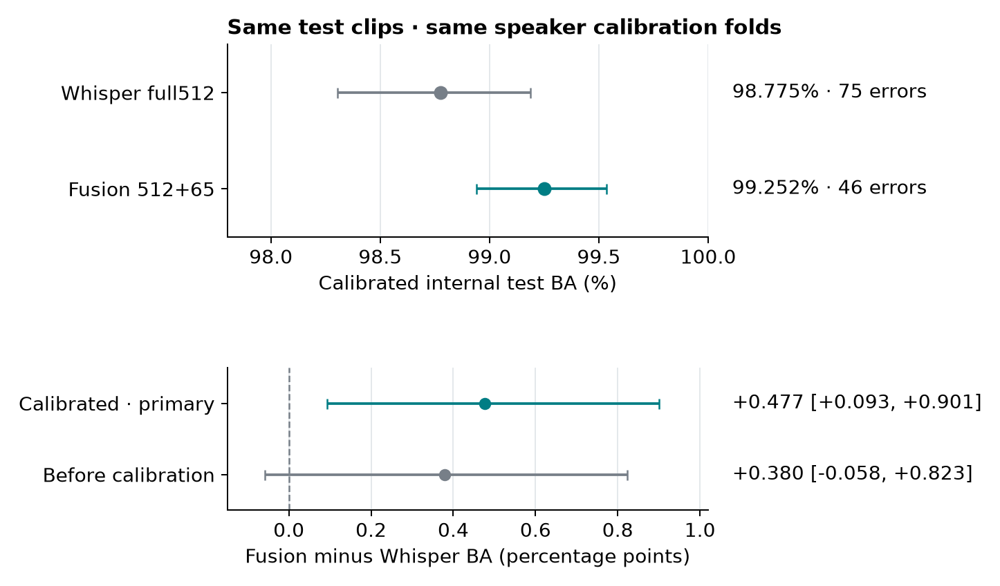

# A2: frozen full512 Whisper versus full512+65 fusion

Run date: 29 October 2026.

**ANSWER** Fusion has a positive calibrated BA difference on this retrospective test.

The calibrated BA difference is **+0.477 [+0.093, +0.901] percentage points**. This is the primary comparison. The interval resamples whole speakers within each class. It does not include model fitting or selection uncertainty.

## Calibrated test results

| Model | Test BA | Macro F1 | FP / FN | Errors |
| --- | --- | --- | --- | --- |
| Whisper full512 SVM | 98.775% | 0.987742 | 41 / 34 | 75 |
| Fusion SVM 512+65 (A2) | 99.252% | 0.992482 | 36 / 10 | 46 |

Both models use the same 6,119 test clips from 1,482 speakers. Singapore has 3,034 clips; non-Singapore has 3,085. Both use p ≥ 0.50.

| Mode | Metric | Change (points) | 95% speaker interval |
| --- | --- | --- | --- |
| calibrated | balanced_accuracy | +0.477 | [+0.093, +0.901] |
| calibrated | macro_f1 | +0.474 | [+0.082, +0.903] |
| raw | balanced_accuracy | +0.380 | [-0.058, +0.823] |
| raw | macro_f1 | +0.376 | [-0.084, +0.830] |

Fusion is correct on 55 disagreements. Whisper is correct on 26. Total disagreements: 81.

## Probability quality

| Model | Brier score ↓ | Log loss ↓ | ROC AUC |
| --- | --- | --- | --- |
| Whisper full512 SVM | 0.009587 | 0.036127 | 0.999089 |
| Fusion SVM 512+65 (A2) | 0.005747 | 0.020413 | 0.999769 |

There is no paired probability-loss interval in this run. Lower observed loss alone does not establish a population gain.

## Source errors

| Source | Clips / speakers | Whisper errors | Fusion errors |
| --- | --- | --- | --- |
| common_voice | 2913 / 1241 | 22 | 20 |
| mnsc | 3034 / 215 | 34 | 10 |
| speech_accent_archive | 50 / 8 | 1 | 3 |
| speechocean762 | 122 / 18 | 18 | 13 |

Each source has one class. Scores cannot separate accent cues from source cues. The two small sources have only 8 and 18 test speakers.

## Fixed method

| Item | Rule |
| --- | --- |
| Encoder | Frozen openai/whisper-base.en; revision 911407f4214e0e1d82085af863093ec0b66f9cd6 |
| Acoustic columns | A1 permutation ranking on original training clips only; fixed count 65 |
| Split | Train 27,797; validation 6,084; test 6,119; no speaker overlap |
| Development | 33,881 clips; 8,443 speakers |
| C grid | 0.01, 0.1, 1, 10; validation BA, macro F1, smaller C |
| Selected C | Whisper: 10; fusion: 10 |
| Whisper search | Reused verified completed E2 search |
| Fusion search | New training-only C trials; no PCA |
| Branch weights | Acoustic: 1/√65; Whisper: 1/√512 |
| Calibration | Same five development speaker folds; sigmoid; ensemble=False |
| Primary | Calibrated fusion minus calibrated Whisper BA; p ≥ 0.50 |
| Secondary | Raw BA, macro F1, source errors, probability loss and cached-head cost |
| Bootstrap | 2,000 paired whole-speaker draws within each class; seed 42 |

## Limits and use

- This test was inspected before this experiment. The result is retrospective. No multiple-comparison correction is applied.
- Acoustic selection uses training clips only. Calibration folds keep columns and C fixed. They do not estimate the complete selection process.
- Source and class are linked. Add new speakers and a second Singapore source for a stronger generalization claim.
- This A2 fusion refit uses different acoustic columns from the 28 October release candidate. Do not assign its scores to that saved candidate.
- The internal test and the earlier 9,000-clip benchmark are not independent. This run does not rerun that benchmark.
- Single-request timings exclude feature extraction, loading, concurrency and the service. They describe this host only.
- No service model or manifest is changed.

## Saved evidence

- `test_predictions.csv`: both thresholds and probabilities for both models.
- `test_metrics.csv`, `paired_comparisons.csv`, `source_metrics.csv`: exact values.
- `validation_trials.csv`, `selected_C.json`, `calibration_folds.csv`: selection and fold records.
- `latency_samples.csv`, `latency_summary.csv`: warm cached-head measurements.
- `protocol.json`, `model_contracts.json`, `run_record.json`: code/input hashes, model contracts and replay checks.
- Fitted artifacts stay in `/home/mh/nusproj/singlish-whisper/outputs/e4_02_5_frozen_full512_vs_fusion_calibrated_20261029`. Their paths and checksums are in the model contracts.
