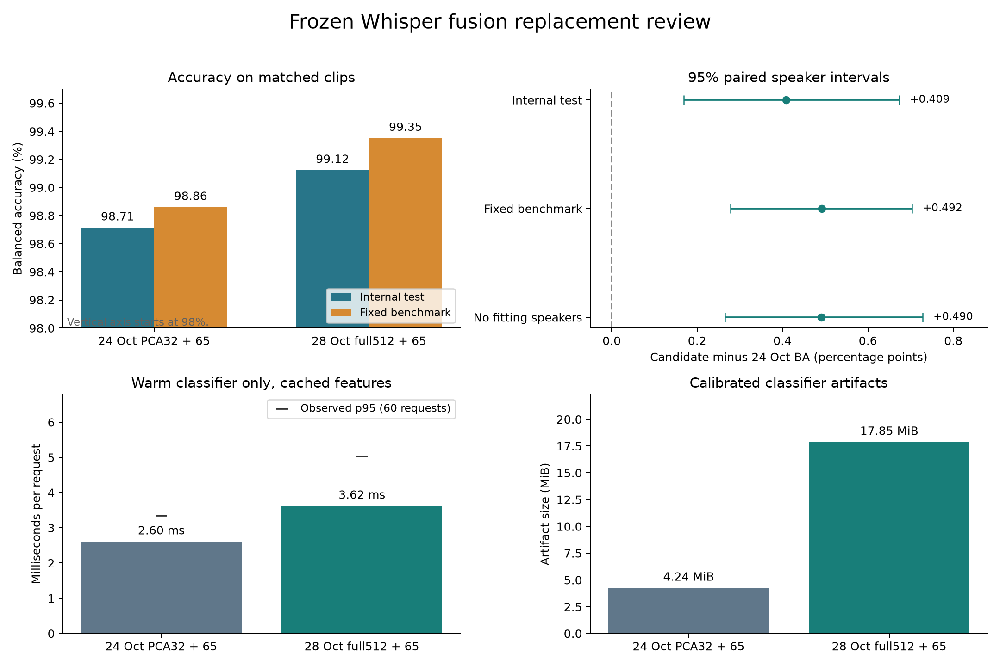

# Full Whisper fusion replacement review

Review date: 28 October 2026. Comparison rerun: 2026-10-28T15:34:34.970916+00:00.

**Decision: advance the 65 acoustic + 512 frozen Whisper model to release validation. Keep the 24 October release in service until target-host and live-audio checks pass.** We have enough saved data for a direct offline comparison. The new calibrated model improves classification and probability scores on both the internal test and the fixed benchmark. We do not yet have enough evidence for an unconditional production replacement or a claim about new recording sources.

The candidate is **frozen `openai/whisper-base.en`**, not the separately fine-tuned Whisper-small encoder. No model was trained or deployed in this review.



## 29 October follow-up: matched full512 control

The separate [A2 study](A2_Full512_vs_Fusion_20261029/README.md) is complete. It uses A1 training-only acoustic columns and the same five calibration folds for both heads. **The A2 comparison shows higher calibrated BA than full512 Whisper on this retrospective test.** The calibrated BA change is **+0.48 [+0.09, +0.90] points**. [Open the completed notebook](notebooks/E4_02_5_frozen_full512_vs_fusion_calibrated.ipynb).

A2 is a new refit. Its columns differ from the 28 October candidate below. The original candidate-versus-release review and benchmark scores remain unchanged.

## Models and notebooks

| Role | Notebook | Effective classifier inputs |
| --- | --- | --- |
| 24 Oct training | [Original concatenation notebook](../../E4_Hybrid_Ensemble_20261024/E4_02_whisper_svm_concatenate.ipynb) | 65 acoustic + 32 Whisper PCA = 97 |
| 24 Oct calibration | [Original calibration notebook](../../E4_Hybrid_Ensemble_20261024/E4_03_whisper_svm_calibrated_probability.ipynb) | Same pipeline; sigmoid; threshold 0.50 |
| 28 Oct training | [Full Whisper concatenation](notebooks/E4_02_whisper_svm_concatenate_full.ipynb) | 65 acoustic + all 512 Whisper = 577 |
| 28 Oct calibration | [Full Whisper calibration](notebooks/E4_03_whisper_svm_calibrated_probability_full.ipynb) | Same pipeline; sigmoid; threshold 0.50 |

The unsuffixed notebooks in `E1_Feature_EngineeringV4` still describe the 24 October PCA32 pipeline. The `_full` notebooks contain the new candidate. Both models accept **577 raw values** at the file interface. The old model reduces Whisper inside its saved pipeline. Raw input width alone cannot identify the new model.

Both use the same 65 acoustic columns, 91-feature cache, full512 embedding cache, clip identities, audio identity and speaker split. The encoder revision resolves to `911407f4214e0e1d82085af863093ec0b66f9cd6`. Both use an RBF SVM with balanced classes. C is 10 for the old model and 1 for the new model. Each branch is scaled and weighted by the inverse square root of its processed width. The old Whisper branch also applies PCA32 and a second scaler. This comparison changes the representation, branch preprocessing and selected C; it does not isolate feature count alone.

The 24 October model checked here is the exact `mvp/models/fusion_svm_c_261024.joblib` artifact recorded in the historical benchmark, not an earlier fusion export.

## Do we have enough data

| Question | Evidence | Assessment |
| --- | --- | --- |
| Can 577 inputs be fitted? | 33,881 development clips from 8,443 speakers; frozen encoder; regularized SVM; five speaker calibration folds. | A fitted, replayable candidate exists. Feature count alone does not establish sample sufficiency. |
| Can we compare internal accuracy? | Same 6,119 test clips; 1,482 speakers; 3,034 Singapore and 3,085 non-Singapore clips. | Yes. Use paired speaker intervals. |
| Can we compare benchmark behavior? | Same fixed 9,000 clips; 8,554 remain after fitting-speaker exclusion. | Yes, with the overlap limits below. |
| Can we compare probability quality? | Same fixed 0.50 threshold; saved probabilities; Brier score and log loss. | Yes, on these populations. |
| Can we compare classifier cost? | Fresh warm prediction timings on one host; artifact sizes and support vectors. | Yes. Audio and service cost are excluded. |
| Can we approve deployment performance? | No matched target-host end-to-end, memory or concurrency test for the candidate. | Not yet. |
| Can we claim new-source accent generalization? | Singapore positives still come only from MNSC. | No. New speakers and another positive source are needed. |

The internal train/validation/test split is 27,797 / 6,084 / 6,119 clips, with 6,939 / 1,504 / 1,482 speakers. No speakers cross those partitions. The Whisper encoder remained frozen. Test clips did not enter the classifier or calibration fit.

## Validation and development folds

| Check | 24 Oct PCA32 + 65 | 28 Oct full512 + 65 |
| --- | ---: | ---: |
| Validation BA (6,084 clips) | 98.691% | 99.280% |
| Three speaker-fold BA range | 98.485% to 98.831% | 99.149% to 99.371% |

The candidate scores higher in all three recorded folds. These folds refit scalers and classifiers, but hold the development-ranked acoustic columns and selected C fixed. They support consistency within this development population; they are not a nested or independent validation of the complete method.

## Internal test results

These are calibrated models at `p(Singapore) >= 0.50`.

| Metric | 24 Oct: 65 + PCA32 | 28 Oct: 65 + full512 |
| --- | --- | --- |
| Accuracy | 98.709% | 99.118% |
| Balanced accuracy | 98.713% | 99.122% |
| Macro F1 | 0.987089 | 0.991175 |
| False positives / false negatives | 55 / 24 | 43 / 11 |
| Errors / 6,119 | 79 | 54 |
| Singapore recall | 99.209% | 99.637% |
| Non-Singapore specificity | 98.217% | 98.606% |
| ROC AUC | 0.998970 | 0.999719 |
| Brier score (lower is better) | 0.010066 | 0.006708 |
| Log loss (lower is better) | 0.038185 | 0.022989 |

The candidate makes **25 fewer errors**, a **31.65% relative reduction**. It corrects 40 release errors and introduces 15 new errors. Candidate minus release BA is **+0.409 [+0.169, +0.673] percentage points**, with a 95% paired speaker interval. The interval supports a gain on this retrospective test.

Before calibration, errors fall from 81 to 64. Raw-model BA gain is **+0.278 [+0.068, +0.513] points**. Calibration improves each model, so the calibrated comparison is the relevant release comparison.

### Source checks

| Source | Clips / speakers | 24 Oct correct | 28 Oct correct | Errors |
| --- | --- | --- | --- | --- |
| Common Voice | 2913 / 1241 | 98.936% | 99.142% | 31 → 25 |
| MNSC | 3034 / 215 | 99.209% | 99.637% | 24 → 11 |
| Speech Accent Archive | 50 / 8 | 92.000% | 94.000% | 4 → 3 |
| SpeechOcean762 | 122 / 18 | 83.607% | 87.705% | 20 → 15 |

For MNSC, “correct” means Singapore recall. For the other sources, it means non-Singapore specificity. The candidate improves each observed source score. Speech Accent Archive and SpeechOcean have only 8 and 18 test speakers. Those samples are too small for a broad source claim.

## Fixed benchmark rerun

We ran both saved calibrated models on the existing benchmark features. The old model reproduces all historical class predictions. PART2 uses the corrected trimmed, RMS-normalized, PCM16 audio features and fresh prepared embeddings, as in the primary 24 October report. No raw/prepared protocols were mixed.

| Set | Clips | 24 Oct | 28 Oct | Errors |
| --- | --- | --- | --- | --- |
| MNSC PART1 recall | 3000 | 97.967% | 98.667% | 61 → 40 |
| MNSC PART2 recall | 3000 | 99.400% | 99.800% | 18 → 6 |
| Common Voice specificity | 3000 | 99.033% | 99.467% | 29 → 16 |
| All clips: accuracy / BA | 9000 | 98.800% / 98.858% | 99.311% / 99.350% | 108 → 62 |

Candidate minus release BA is **+0.492 [+0.278, +0.703] points**. Brier score falls from 0.009299 to 0.005197; log loss falls from 0.033270 to 0.018285.

The full benchmark contains 446 Common Voice clips from fitting speakers, including 137 fitting clip identities. After we remove all fitting speakers, **8,554 clips** remain. BA rises from **98.833% to 99.323%**; errors fall from **105 to 61**. The paired BA gain remains **+0.490 [+0.266, +0.728] points**.

This benchmark is not independent confirmation on new Singapore speakers. All its MNSC speakers also occur in the study test partition. Benchmark MNSC clip IDs do not overlap the study IDs, but speaker and corpus exposure remain. Common Voice also contains 378 clip identities from the full study. Do not combine internal and benchmark sample counts or their intervals as independent evidence. Exact counts are in [the overlap audit](comparison/benchmark_overlap.json).

## Performance and compatibility

| Measurement | 24 Oct | 28 Oct | Meaning |
| --- | --- | --- | --- |
| Single request median / observed p95 | 2.60 / 3.35 ms | 3.62 / 5.03 ms | 1.39× median time |
| 256-clip batch median / observed p95 | 74.24 / 79.82 ms | 457.83 / 459.63 ms | 6.17× median time |
| Calibrated artifact size | 4.24 MiB | 17.85 MiB | 4.21× |
| Support vectors | 3760 | 3739 | Similar count; wider vectors |
| Processed SVM inputs | 97 | 577 | 5.95× dimensions |
| Saved final uncalibrated fit | 8.34 s | 51.46 s | Separate original runs |
| Saved five-fold calibration + final refit | 54.7 s | 412.8 s | Separate original runs |

Fresh latency measurements use the same host, four BLAS threads, the same cached raw input features and `predict_proba`. We alternate model order. Each model receives five batches of 256 clips and 60 single-clip requests after warm-up. The p95 values describe these small observed samples. They are not service guarantees. Raw observations are in [latency_samples.csv](comparison/latency_samples.csv).

The new model is slower for batch scoring and larger on disk. Its single-request classifier adds about **1.01 ms** at the median on this host. The measurements exclude audio decode, trimming, acoustic extraction, Whisper inference, model loading, API overhead and concurrent requests. They cannot establish end-to-end response time or peak RAM. Original fit/calibration timings came from separate runs and are descriptive.

The existing `mvp.models.EnsembleModel` loader accepts the candidate and its sidecar metadata. One cached prediction passes through that loader. The raw input width, selected columns, class order and resolved Whisper revision match the current interface. This is a compatibility check, not a deployment test. The service files and model manifest are unchanged.

## Findings from the other E4 notebooks

| Notebook | Relevant evidence | Use in this decision |
| --- | --- | --- |
| [E4_02_1](notebooks/E4_02_1_tuned_acoustic_svm_whisper_and_fusion.ipynb) | Ranks acoustic65 on training speakers only. Compares acoustic, frozen full512, PCA32 and PCA32 fusion under one C rule. | Use its selection method for a cleaner future full512 fusion comparison. |
| [E4_02_2](notebooks/E4_02_2_finetuned_whisper_svm_and_fusion.ipynb) | Compares frozen and fine-tuned Whisper-small with the base.en controls. | Different encoder and exposure risks; not the 577-input candidate. |
| [E4_02_3](notebooks/E4_02_3_fusion_enabled.ipynb) | Frozen-small fusion65+32 has 39 errors; fine-tuned-small fusion65+32 has 58. | Fusion benefit depends on the encoder and representation. Do not mix these with calibrated base.en release scores. |
| [E4_02_4](notebooks/E4_02_4_finetuned_feature_ablation.ipynb) | Fine-tuned full768 has 37 errors; PCA32-alone 144; fusion65+32 58; fusion65+768 29. | Compression can remove useful information. Full768 fusion minus full768 alone has BA interval [-0.123, +0.417] points, so added acoustic benefit is not established. |

The fine-tuned model studies lack the complete 15k ASR training and checkpoint-selection exposure manifest. Their reports explicitly leave that audit unresolved. Their high scores cannot establish independent speaker generalization. This unresolved project ASR exposure applies to those fine-tuned candidates, not to the new frozen base.en model.

The separate `E4_02_whisper_e1_feature_fusion_beginner.ipynb` uses the 2,000-clip pilot. It is not evidence for this 40,000-clip release comparison.

We also compared the uncalibrated 577-input candidate with the completed frozen base.en full512-only SVM: **+0.233 [-0.217, +0.664] points**. The interval includes zero. The new candidate beats the old PCA32 fusion on these data, but a gain from adding acoustic features over full512 Whisper alone is not established. This secondary comparison uses the completed E2 control; it is not a new calibrated head-to-head study.

## Notebook review and limits

1. **Feature selection uses development labels.** The [E1 notebook](notebooks/E1_acoustic_91_feature_count_comparison.ipynb), final-refit cell, ranks the full91 model on all development clips before saving the 65 columns. Both old and new fusion notebooks import those columns. Validation labels have therefore influenced the representation before C selection. The three-fold checks and five-fold calibration also hold these columns fixed; they do not repeat feature selection inside each fold. They are not nested estimates of the complete selection process. The separate test remains outside fitting, so this does not erase the paired test comparison.
2. **The test has been inspected repeatedly.** This candidate was explored after earlier results. Architecture choice and repeated comparisons can overstate a gain. The 2,000 speaker-bootstrap intervals condition on the fitted models. They exclude training, feature-selection and architecture-selection uncertainty. No multiple-comparison correction was applied.
3. **Class and corpus are linked.** All Singapore clips are MNSC. Source, microphone, room and prompt cues can contribute to accuracy. Neither large clip counts nor a small interval resolves this problem.
4. **Future reruns need a pinned encoder revision.** The training notebook requests `revision='main'`. The current cache records the resolved commit, and both current models use that exact cache. Set the explicit commit for future extraction.
5. **Scalers and calibration are saved correctly.** The full model preserves all 512 Whisper values, scales both branches, uses the recorded C and fits sigmoid calibration from speaker-separated development scores. Original/raw decisions replay; saved calibrated classes replay with zero differences. The old artifact shows a maximum probability difference of 3.65e-07 on this runtime; the new artifact differs by only floating-point rounding. The review allows at most 1e-6 absolute probability drift and still requires identical classes.

## Replacement recommendation

**Select full512 + acoustic65 as the next frozen-base candidate.** Its advantage over the 24 October fusion is consistent across internal accuracy, the fixed benchmark, fitting-speaker exclusion, and probability losses. The measured single-request head cost is small in absolute terms, although batch cost and artifact size increase.

Before replacing the live release:

| Check | Required evidence |
| --- | --- |
| Target-host performance | Measure end-to-end p50/p95, cold start, peak RSS and concurrent requests with both models under the same CPU and thread limits. Check the application's latency and memory budgets. |
| Live and rejection behavior | Use matched recordings across microphones, rooms, quiet speech and background noise. Repeat the non-English/outlier check for the candidate; only the older releases have the existing 28-clip result. Keep the threshold fixed. |
| Packaging | Export the candidate artifact and matching sidecar with a distinct version and checksum. Keep the 24 October artifact available for rollback. The runtime loader check passed; the service has not been changed. |

For a stronger scientific claim, also run a training-only acoustic selection comparison with calibrated full512-only and full512+65 heads. Reserve new speakers before inspecting scores and add Singapore recordings from a second source. Do not treat the existing 9,000 benchmark as that independent set.

## Saved evidence and reproduction

- [Comparison outputs](comparison/) contain paired predictions, metrics, source checks, overlap audit, timings, model contracts and verification.
- [Notebook snapshots](notebooks/) contain the seven original executed notebooks plus the completed A2 follow-up. Open them for recorded code and output. Rerun the original studies in their source project directories; this snapshot does not copy their audio, caches or fitted binaries.
- [Source evidence](evidence/) contains model metadata, C trials, fold results and the context reports. The original 24 October notebooks remain in their existing archive.
- [Archive manifest](archive_manifest.json) records copied sources and SHA256 hashes. The verification file records the model and cache hashes used for the new comparison. Both fitted artifacts remain in their source locations.

To repeat this review on this workstation:

```bash
/home/mh/miniconda3/envs/singlish-py314/bin/python /home/mh/nusproj/Singlish/results/Report_20261031/E1_Feature_Engineering_20261028/review_models.py
```

This reruns frozen-artifact predictions, paired intervals, benchmark checks, classifier timing and the isolated runtime loader check. It does not retrain models, change source notebooks or deploy a model. Timings can change with host load. The Markdown report is a snapshot of the recorded run.
