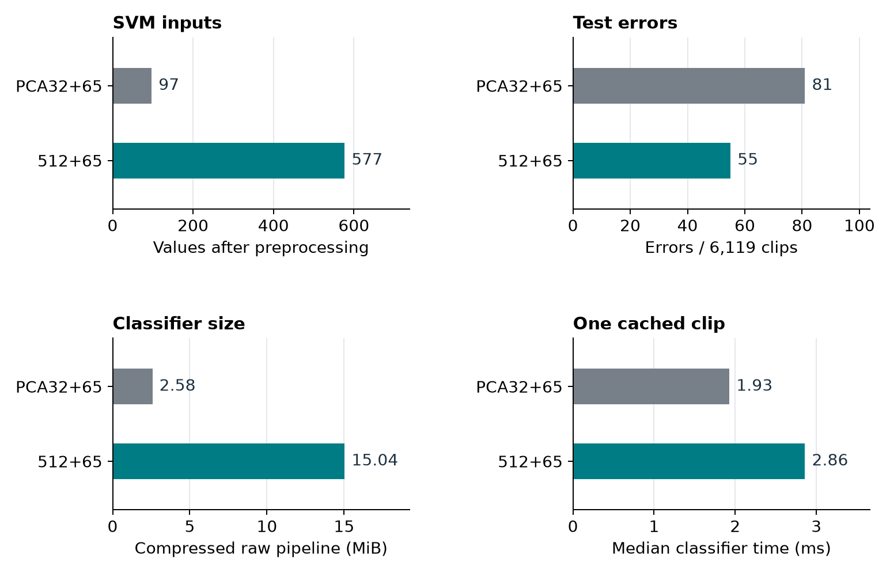

# PCA compression: PCA32+65 versus 512+65

29 October 2026 | Saved-model comparison | No retraining

**Result:** PCA32+65 uses fewer SVM inputs, a smaller classifier, and less classifier time. It loses **0.424 [0.187, 0.684] balanced-accuracy points** and makes **26 more errors** on this test.

Both pipelines use the same frozen Whisper-base.en revision, cached features, training-ranked 65 acoustic columns, data split, development refit, and RBF SVM C = 10. Both use **decision score ≥ 0, before calibration**. Do not compare these numbers directly with the calibrated primary comparison.

| Measure | PCA32+65 | 512+65 |
| --- | ---: | ---: |
| Whisper values after preprocessing | 32 | 512 |
| SVM inputs | 97 | 577 |
| Test balanced accuracy | 98.682% | 99.106% |
| Accuracy | 98.676% | 99.101% |
| Macro F1 | 0.9868 | 0.9910 |
| False Singapore / missed Singapore | 62 / 19 | 47 / 8 |
| Errors / 6,119 | 81 | 55 |
| Raw pipeline size, compress=3 | 2.58 MiB | 15.04 MiB |
| One cached clip, median / observed p95 | 1.93 / 2.92 ms | 2.86 / 4.10 ms |
| Batch of 256, median | 65.96 ms | 433.41 ms |
| Support vectors | 3,463 | 3,538 |

512+65 minus PCA32+65: BA **+0.424 [+0.187, +0.684]** points; macro F1 **+0.425 [+0.186, +0.683]** points. Of 62 disagreements, 512+65 is correct on 44; PCA32+65 is correct on 18.



PCA reduces the Whisper width by **93.75%** and the SVM input count by **83.19%**. The raw classifier is **82.85% smaller**. The observed single-clip median time is **32.58% lower**. PCA retains **50.0%** of development-set Whisper variance. Variance retention does not measure accent information.

Whisper still extracts all 512 values before PCA. These savings apply to the classifier. They do not measure encoder time, total service time, RAM, loading, or concurrency. Both serialized pipelines accept the same 577 raw input values. The encoder is excluded from their sizes.

The comparison covers two specified pipelines. PCA32+65 adds PCA and component scaling. Its Whisper block weight is 1/√32 instead of 1/√512. Both use gamma = scale, which is calculated from transformed inputs. Thus the result includes the specified scaling and weighting, as well as compression.

Intervals use 2,000 paired whole-speaker samples within each class, seed 42. Both models use 6,119 test clips from 1,482 speakers. Intervals keep fitted models fixed and exclude training and selection uncertainty. Repeated test use and the source/class link limit generalization.

Measurements use four BLAS threads on one host, 60 single-clip requests and five 256-clip batches per model, after warm-up and with alternating order. Each call includes preprocessing and `decision_function`. It excludes feature extraction. Serialized sizes use the same `joblib.dump(..., compress=3)` method for each raw pipeline. No calibrated wrapper is included.

The saved pipelines reproduce all saved test classes. The maximum PCA score difference is 5.52 × 10⁻⁷, within the recorded 10⁻⁶ absolute tolerance for float32 transforms. All source hashes remain unchanged.

Evidence files:

- `compare_saved_models.py`: reproducible comparison; reads original caches and models at recorded paths.
- `metrics.csv`, `paired_comparisons.csv`: exact results and intervals.
- `test_predictions.csv.gz`: both replayed test decisions, with IDs, labels, sources, and speakers.
- `latency_samples.csv`: each classifier timing sample.
- `run_record.json`: source hashes, controls, software versions, and replay checks.
- `compression_tradeoff.png`: report chart.

Run from the project root:

```bash
/home/mh/miniconda3/envs/singlish-py314/bin/python results/Report_20261031/E1_Feature_Engineering_20261028/PCA32_Compression_Comparison_20261029/compare_saved_models.py
```

Source pipelines: `E4_02_1` training-ranked PCA32+65 and the final raw estimator inside the `E4_02_5` 512+65 calibrated artifact. Original binaries and caches are required to repeat the replay and timing; portable metrics and predictions are included here.
