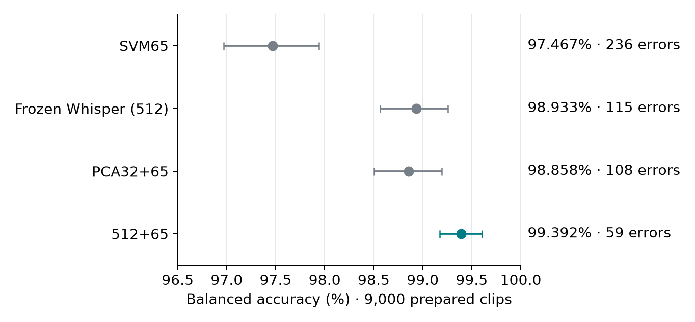

# Performance comparison

29 October 2026 | Saved calibrated models | Common prepared inputs | p ≥ 0.50

**512+65 gives 99.392% BA with 59 errors. Frozen Whisper gives 98.933% BA with 115 errors.** The paired BA gain is **+0.458 [+0.196, +0.753] percentage points**. Fusion makes **56 fewer errors (48.7%)**.

The performance set contains 3,000 MNSC PART1, 3,000 MNSC PART2 and 3,000 Common Voice clips. It has 2,684 unique speakers. The class counts are 6,000 Singapore and 3,000 non-Singapore clips. BA gives both classes equal weight; accuracy weights each clip equally.

| Model | BA | Accuracy | Macro F1 | Errors / 9,000 |
| --- | --- | --- | --- | --- |
| SVM65 | 97.467% | 97.378% | 0.9707 | 236 |
| Frozen Whisper (512) | 98.933% | 98.722% | 0.9857 | 115 |
| PCA32+65 | 98.858% | 98.800% | 0.9866 | 108 |
| 512+65 | 99.392% | 99.344% | 0.9926 | 59 |



Lines give 95% whole-speaker intervals. BA and F1 are clip-based. Fit artifacts are fixed during resampling.

| Group (3,000 clips each) | SVM65 | Frozen Whisper (512) | PCA32+65 | 512+65 |
| --- | --- | --- | --- | --- |
| PART1: Singapore recall | 97.20% | 96.97% | 97.97% | 98.77% |
| PART2: Singapore recall | 97.20% | 99.63% | 99.40% | 99.73% |
| Common Voice: specificity | 97.73% | 99.57% | 99.03% | 99.53% |

The main comparison uses the **same 29 October frozen Whisper and 512+65 artifacts as Section 7 of the training report**. SVM65 and PCA32+65 use the verified 24 October calibrated artifacts. All use a fixed probability threshold of 0.50. No fitting, calibration fitting, feature selection, threshold tuning or deployment occurs here.

| Model | Saved fit | SVM inputs / C | Acoustic ranking |
| --- | --- | --- | --- |
| SVM65 | 24 October | 65 / 1 | Development |
| Frozen Whisper (512) | 29 October | 512 / 10 | None |
| PCA32+65 | 24 October | 97 / 10 | Development |
| 512+65 | 29 October | 577 / 10 | Training only |

All Whisper branches use frozen `openai/whisper-base.en`, revision `911407f4214e0e1d82085af863093ec0b66f9cd6`. The two 29 October heads use shared five-speaker-fold calibration from their original fit. The PCA32+65 and 512+65 rows also differ in their acoustic columns, so this table does not isolate PCA compression. The dedicated PCA comparison uses the same training-ranked columns and raw decisions.

## Unseen-audio scope and overlap check

The source manifests mark this performance set as `unseen`. Both MNSC groups have zero clip-ID and speaker overlap with classifier training/validation. Their speakers occur in the study test split. Common Voice has 137 clip IDs in training/validation and 446 clips from training/validation speakers. These are ID and speaker checks, not a fresh waveform-identity audit.

| Model | BA: exclude fit clip IDs (8,863) | BA: exclude fit speakers (8,554) | Errors / 8,554 |
| --- | --- | --- | --- |
| SVM65 | 97.447% | 97.484% | 225 |
| Frozen Whisper (512) | 98.923% | 98.915% | 114 |
| PCA32+65 | 98.835% | 98.833% | 105 |
| 512+65 | 99.381% | 99.370% | 58 |

| Subset | 512+65 minus frozen Whisper BA (points) | 95% speaker interval |
| --- | --- | --- |
| All 9,000 clips | +0.458 | [+0.196, +0.753] |
| Exclude 137 fit clip IDs | +0.458 | [+0.182, +0.753] |
| Exclude 446 fit-speaker clips | +0.455 | [+0.193, +0.759] |

After fitting-speaker exclusion, all four models use the same remaining 8,554 clips. Results retain the same model ranking by BA. The set remains related to the study test through MNSC speakers. Repeated inspection and source/class confounding limit a claim about other recording sources.

## Method and checks

- Reuse the exact prepared PART1 and Common Voice feature caches.
- Use the corrected PART2 cache: silence trim, RMS normalization, PCM16 quantization/decode, matching acoustic and Whisper inputs.
- Verify cache, model, manifest and split hashes against original records.
- Apply each saved model with its exact acoustic-column order and input width.
- Reproduce every saved SVM65 and PCA32+65 class on the 9,000 clips; probability differences stay below 10⁻⁶.
- Calculate 2,000 paired whole-speaker samples within each class, seed 42. Intervals keep fitted models fixed and exclude fitting and selection uncertainty.
- Confirm all input files remain unchanged. Prediction-call durations in the run record are diagnostic values, not a service latency benchmark.

## Evidence

- `evaluate_saved_models.py`: reproduction script; requires the original model binaries and caches at recorded paths.
- `predictions.csv.gz`: all 36,000 labels and probabilities, with clip IDs, speakers and overlap flags.
- `metrics.csv`: overall, source and overlap-exclusion results.
- `paired_comparisons.csv`: BA and F1 changes with speaker intervals.
- `model_contracts.json`: exact saved fits, hashes, feature columns and settings.
- `overlap_audit.json`, `run_record.json`: overlap counts, source hashes, replay checks and environment.
- `performance_comparison.png`: report chart.

Run from the project root:

```bash
/home/mh/miniconda3/envs/singlish-py314/bin/python results/Report_20261031/E1_Feature_Engineering_20261028/Performance_Comparison_9000_20261029/evaluate_saved_models.py
```

The run record retains the original script hash. The script root path was adjusted after consolidation.
