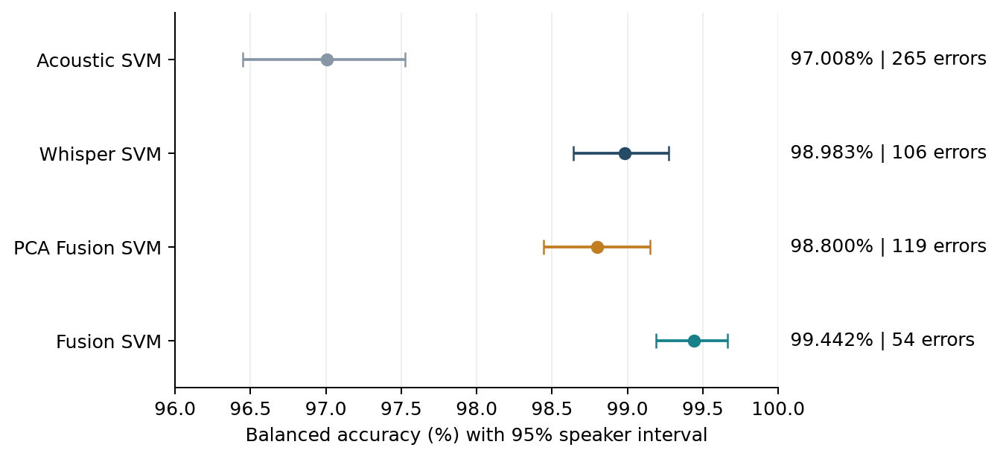

# Performance test on 9,000 new recordings

29 October 2026 | Four frozen calibrated models | Probability threshold 0.50

Fusion SVM achieves **99.442% balanced accuracy with 54 errors**. Whisper SVM achieves **98.983% with 106 errors**. Fusion makes 52 fewer errors; its paired balanced-accuracy difference is **+0.458 percentage points [+0.236, +0.688]**.

## What unseen means here

No selected speaker was used in classifier training or validation, including the development refits and calibration. Every recording is absent from the complete 40,000-clip study and the earlier 9,000-clip benchmark according to source identities and the checks below. Original study-test speakers are allowed. Thus the recordings and fitting-speaker exclusions are new, but the test is not independent of all earlier evaluation.

| Group | Clips | Speakers | Speakers also in original test | Clips from original test speakers |
| --- | ---: | ---: | ---: | ---: |
| mnsc_part1 | 3,000 | 157 | 157 | 3,000 |
| mnsc_part2 | 3,000 | 160 | 160 | 3,000 |
| common_voice | 3,000 | 1,735 | 277 | 462 |

There are 1,950 distinct speakers overall. Speakers shared between PART1 and PART2 count only once in this total and are resampled together in the confidence intervals. Class counts are 6,000 Singapore and 3,000 non-Singapore; balanced accuracy weights the two classes equally.

## Overlap verification

All three groups passed with **zero** training/validation speaker overlap, zero study or old-benchmark clip-ID overlap, zero recorded raw/PCM hash overlap, zero MNSC source-file/row overlap, and zero existing normalized speaker/transcript matches. New prepared PCM hashes are unique across all 9,000 clips. Checks use all 40k partitions when excluding recordings and use train plus validation when excluding fitting speakers.

Source coordinates prevent renamed MNSC IDs from appearing new. Speaker/transcript exclusions also remove repeated microphone-channel versions of the same utterance. Available hashes identify exact duplicates; no perceptual fingerprinting or independent speaker recognition was performed. Speaker independence relies on the source speaker IDs.

## Results

| Model | Balanced accuracy [95% speaker interval] | Accuracy | Macro F1 | FP | FN | Errors |
| --- | --- | ---: | ---: | ---: | ---: | ---: |
| Acoustic SVM | 97.008% [96.449, 97.526] | 97.056% | 0.9671 | 94 | 171 | 265 |
| Whisper SVM | 98.983% [98.643, 99.272] | 98.822% | 0.9868 | 16 | 90 | 106 |
| PCA Fusion SVM | 98.800% [98.445, 99.149] | 98.678% | 0.9852 | 25 | 94 | 119 |
| Fusion SVM | 99.442% [99.189, 99.665] | 99.400% | 0.9933 | 13 | 41 | 54 |

FP means a non-Singapore clip incorrectly labelled Singapore; FN means a Singapore clip missed.

| Group | Acoustic SVM errors | Whisper SVM errors | PCA Fusion SVM errors | Fusion SVM errors |
| --- | ---: | ---: | ---: | ---: |
| mnsc_part1 | 96 | 76 | 70 | 34 |
| mnsc_part2 | 75 | 14 | 24 | 7 |
| common_voice | 94 | 16 | 25 | 13 |

## Fixed method and sampling

- The protocol and four saved model checksums were locked before new predictions. No training, calibration fitting, feature selection or threshold tuning used this set.
- Singapore clips come exclusively from pinned MNSC PART1/PART2 training-source shards. Source corpus “Train” is distinct from this project’s training split: candidate speakers were explicitly excluded using the project manifests.
- MNSC source shards and rows use seeded order, then speaker round-robin selection with at most 30 clips per speaker per group. The selected set is screened for cross-group duplicate audio and utterances.
- Common Voice uses a prepared CV26 reserve followed by the local CV26 archive until a 4,500-candidate pool is reached, then seeded speaker round-robin selection with at most ten clips per speaker. Negative accent labels must be unambiguous. Singaporean and conflicting speaker labels are excluded. This convenience candidate pool has no accent quotas.
- All groups use mono 16 kHz audio, 40 dB RMS silence trimming with 100 ms edge padding, 3–6-second duration eligibility after trimming, -20 dBFS RMS normalization with a 0.99 peak limit, and PCM16 encode/decode. Both feature branches receive the same decoded waveform. No new crop is introduced for overlength recordings; they are rejected.
- The frozen Whisper-base.en revision is 911407f4214e0e1d82085af863093ec0b66f9cd6. Encoder pooling averages real-audio frames and excludes padding frames. Extraction uses CUDA bfloat16.
- Acoustic SVM and PCA Fusion SVM are the 24 October development-ranked saved fits. Whisper SVM and Fusion SVM are the 29 October fits, with Fusion using training-ranked acoustic columns. This matches the four-model comparison in the existing report and does not isolate PCA compression.
- Intervals use 2,000 paired whole-speaker bootstrap draws within class, seed 42. The primary comparison is Fusion SVM minus Whisper SVM balanced accuracy. Other comparisons are secondary; no multiple-comparison adjustment is applied.

Common Voice selected accent counts: British: 532, American: 2,070, Australian: 129, South Asian: 257, Filipino: 12.

## Interpretation and limits

The primary paired interval is above zero, supporting an observed Fusion SVM advantage for these fixed models on this sample.

Original test speakers recur, sources remain linked to class, and neither convenience sampling nor these intervals establishes performance on the general speaker population or new recording sources. Intervals exclude model-fitting and selection uncertainty. “Unseen” refers to classifier fitting, not the pretrained Whisper corpus. The new benchmark must not be used for retuning and then presented as untouched.

## Reproducibility

See [README.md](README.md) for commands and external source/artifact requirements. `protocol.json` and `model_lock.json` retain pre-prediction decisions. `manifest.csv.gz`, per-group manifests, preparation records and `overlap_audit.json` retain identities and exclusions. `predictions.csv.gz`, `metrics.csv` and `paired_comparisons.csv` retain results. `feature_record.json` and `run_record.json` retain hashes, runtime and saved-model verification. Prepared audio and feature caches remain under `outputs/performance_test_unseen_9000_20261029/`. The earlier benchmark and training reports were not overwritten.
