# Singapore English accent classification

Classifier training and evaluation | 29 October 2026

> **HOW TO READ** Each section starts with a QUESTION. The method and the results follow. An ANSWER and a DECISION close the section. BA is balanced accuracy. Points are percentage points. Square brackets give 95% speaker intervals.

## 1 Scope, workflow, and answers

> **QUESTION** Which classifier do we report, and which evidence supports the choice?

This chapter covers classifier training and testing for experiments E1 to E4 of the proposal [1]. Other chapters cover the system design, live interface, and transcription.

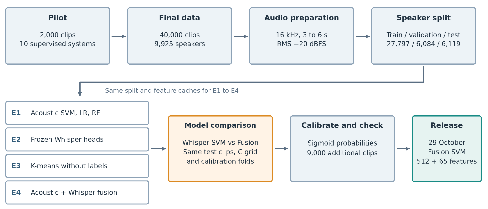

**Figure 1.** Workflow from the pilot through model comparison, calibration, and release.

**Table 1. Answers to the main questions**

| Question | Answer | Section |
| --- | --- | :---: |
| Which methods go to the full study? | E1: LR, SVM, and RF. E2: frozen Whisper. E4: feature fusion. Stop i-vector, x-vector, ECAPA-TDNN, and voting. | 2 |
| Can the test measure new speakers? | Yes. No speaker is in two partitions. Source and class stay linked. | 3 |
| Which acoustic model is the baseline? | RBF SVM with 65 of 91 features: 96.56% test BA. | 4 |
| Do frozen Whisper features beat acoustic features? | Yes. +2.16 points [1.35, 3.01]; 78 errors against 211. | 5 |
| Do the features form accent groups without labels? | Weakly. ARI is 0.182. The Singapore cluster holds 46.3% of Singapore clips. | 6 |
| Does fusion beat the best single model? | Yes, after calibration. +0.477 points [0.093, 0.901]; 46 errors against 75. | 7 |
| Are the probabilities usable at p ≥ 0.50? | Yes, on this test. Brier score is 0.0057 against 0.0096. | 8 |
| Does PCA compression help? | It makes the saved pipeline 82.8% smaller but adds 26 errors. | 9 |
| Does the ranking hold on 9,000 more clips? | Yes. 54 errors against 106. The set is related, not independent. | 10 |
| Which model do we report? | Fusion SVM. | 11 |

> **ANSWER** Fusion SVM gives the highest BA on the study test: 99.252% with 46 errors. Whisper SVM gives 98.775% with 75 errors. Section 11 gives the limits of this result.

<!-- pagebreak -->

## 2 Pilot study

> **QUESTION** Which methods should the full study use?

The pilot compares ten supervised systems on the same 2,000 clips: 1,000 MNSC and 1,000 Common Voice clips [3]. Training, validation, and test contain 1,280, 320, and 400 clips from 566, 141, and 176 speakers. No speaker is in two partitions.

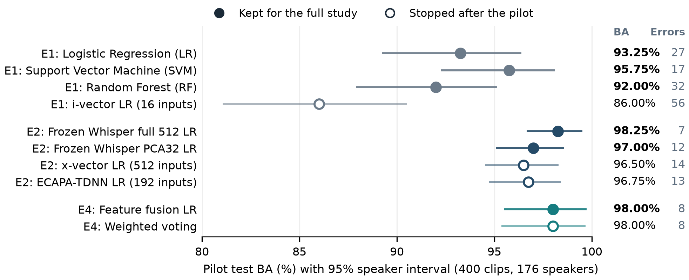

**Figure 2.** Pilot test BA. Lines show 95% speaker intervals from 2,000 bootstrap samples. Filled points go to the full study.

**Table 2. Pilot decisions**

| Experiment | Keep | Stop | Reason |
| --- | --- | --- | --- |
| E1 | LR, SVM, RF | i-vector LR | i-vector BA is 86.00%. The acoustic models give 92.00% to 95.75%. |
| E2 | Frozen Whisper full 512 and PCA32 | x-vector, ECAPA-TDNN | Whisper full 512 gives the highest BA. The other two are 1.75 and 1.50 points lower; both intervals include zero. We stop them to limit the scope. |
| E4 | Feature fusion | Weighted voting | Both give 98.00% and 8 errors. Fusion trains one model and needs one calibration. |

> **ANSWER** Frozen Whisper full 512 LR has the highest pilot BA: 98.25% with 7 errors. Feature fusion and voting each give 98.00% with 8 errors. A one-error lead is not a reliable difference.

> **DECISION** Take LR, SVM, and RF to E1, frozen Whisper to E2, and feature fusion to E4.

> **LIMIT** The pilot uses one split, two sources, and LR heads. Its audio preparation is different (30 dB trim, peak normalization). Do not compare pilot BA with full-study BA.

<!-- pagebreak -->

## 3 Data and test protocol

> **QUESTION** Can the test measure performance on speakers that the models did not see?

Class 1 is Singapore English accent. Class 0 is non-Singapore English accent. Corpus labels set the class. The models do not identify ethnicity, nationality, or identity [1, 2].

**Table 3. Data sources. Each source gives clips of one class only.**

| Source | Class | Accent groups | Clips |
| --- | --- | --- | ---: |
| MNSC Extended | Singapore | PART1: 7,500 clips; PART2: 12,500 clips | 20,000 |
| Common Voice English | Non-Singapore | American, British, Australian, Filipino, South Asian, Hong Kong | 18,871 |
| speechocean762 | Non-Singapore | Mainland Chinese (adults only) | 800 |
| Speech Accent Archive | Non-Singapore | Korean | 329 |
| Total | 20,000 per class | 9,925 speakers | 40,000 |

**Table 4. Speaker partitions and their use**

| Partition | Non-Singapore | Singapore | Speakers | Use |
| --- | ---: | ---: | ---: | --- |
| Training | 13,848 | 13,949 | 6,939 | Rank acoustic features. Fit models. |
| Validation | 3,067 | 3,017 | 1,504 | Select the feature count and the SVM setting C. |
| Development = training + validation | 16,915 | 16,966 | 8,443 | Fit the final models. Calibration folds. E3. |
| Test | 3,085 | 3,034 | 1,482 | Report results only. No fitting. |

- One speaker is in one partition only. This rule also applies across MNSC PART1 and PART2.
- MNSC gives a maximum of 30 clips for each speaker.
- The partitions hold 69.9%, 15.2%, and 14.9% of the speakers. The proposal target is 70/15/15 [2].
- All random steps use seed 42. File hashes link the audio, features, splits, and saved models.

### 3.1 One audio preparation for all clips

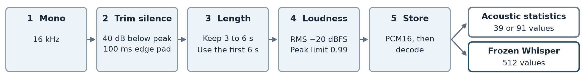

**Figure 3.** Audio preparation. Both feature branches receive the same prepared waveform.

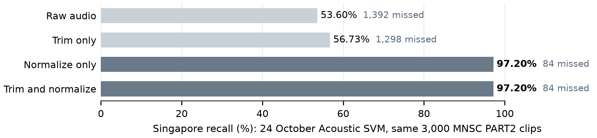

**Figure 4.** Effect of a preparation mismatch. Loudness normalization recovers 1,308 of the 1,392 missed clips [11].

The same check raises the recall of the 24 October PCA Fusion SVM from 91.70% to 99.40%. Thus training and use must apply the same preparation.

### 3.2 Models and selection rules

**Table 5. Model names in this chapter**

| Report name | Inputs to the SVM | SVM features |
| --- | --- | ---: |
| Acoustic SVM | 65 selected acoustic statistics | 65 |
| Whisper SVM | 512 frozen Whisper encoder values | 512 |
| PCA Fusion SVM | 32 PCA components of the Whisper values and 65 acoustic statistics | 97 |
| Fusion SVM | 512 Whisper values and 65 acoustic statistics | 577 |

All Whisper models in the full study use the frozen `openai/whisper-base.en` encoder. A support vector machine (SVM) with a radial basis function (RBF) kernel learns the class boundary. Principal component analysis (PCA) decreases the feature count.

**Table 6. Data that each step uses**

| Step | Data | Rule |
| --- | --- | --- |
| Rank acoustic features | Training | Shuffle each feature five times. Rank by the loss of BA. |
| Select the feature count | Validation | Compare ranked subsets with the full feature set. |
| Select C | Training and validation | Test 0.01, 0.1, 1, and 10. Prefer validation BA, then macro F1, then the smaller C. |
| Fit the final models | Development | Fit the scaler and the SVM again. Keep the selected columns and C. |
| Calibrate | Five development speaker folds | Fit a sigmoid to scores from speakers that each fold model did not see. |
| Test | Test | Predict Singapore when p ≥ 0.50. |
| Find intervals | Test speakers | Resample whole speakers in each class, 2,000 times. Use the same samples for both models. |

**Table 7. Measures**

| Measure | Meaning |
| --- | --- |
| Balanced accuracy (BA) | Mean of Singapore recall and non-Singapore specificity. Both classes have equal weight. |
| Precision, recall, F1 | Precision: correct share of a predicted class. Recall: found share of a reference class. F1 joins the two. |
| False positive (FP), false negative (FN) | FP: a false Singapore label. FN: a missed Singapore clip. |
| Brier score, log loss | Errors of the probability values. Lower is better. |

The intervals keep the fitted models fixed. They do not include uncertainty from training and model selection. Scores are clip based, so speakers with more clips have more weight.

> **ANSWER** Yes, for new speakers. No speaker is in two partitions. The test supplies no fitted value and no threshold.

> **LIMIT** All Singapore clips come from MNSC. All non-Singapore clips come from other sources. Thus a model can use recording cues as well as accent cues. The team inspected the test during earlier experiments.

<!-- pagebreak -->

## 4 E1 Traditional machine learning

> **QUESTION** Which classical classifier is the best acoustic baseline, and which features does it need?

**Table 8. Acoustic feature sets**

| Set | Features | Content |
| --- | ---: | --- |
| Base | 39 | Mean and standard deviation of 13 MFCCs (26). Pitch, voiced ratio, spectral shape, zero-crossing rate, and RMS energy (13). |
| MFCC delta | 26 | Mean and standard deviation of the frame-to-frame MFCC change |
| MFCC delta-delta | 26 | Mean and standard deviation of the change of the delta |
| Full pool | 91 | Base, delta, and delta-delta |

Librosa uses a 64 ms window and a 16 ms step. Pitch uses YIN. LR and the RBF SVM use C = 1. RF uses 300 trees. All use balanced class weights and seed 42 [4].

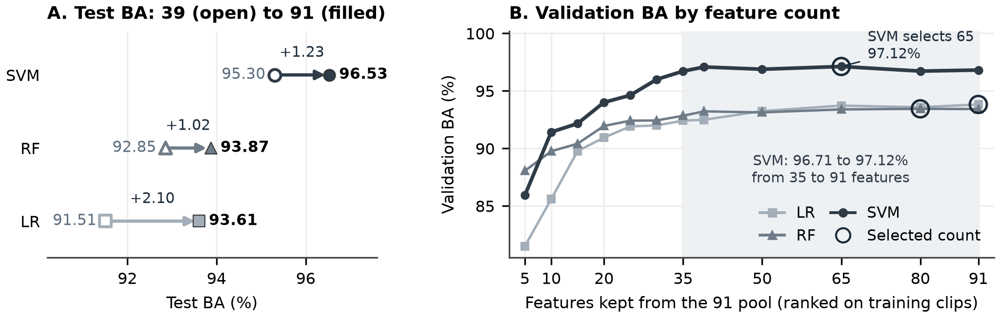

**Figure 5.** A: test BA with the base 39 and the full 91 features. B: validation BA when each classifier keeps its top-ranked features. Rings show the count that validation selects.

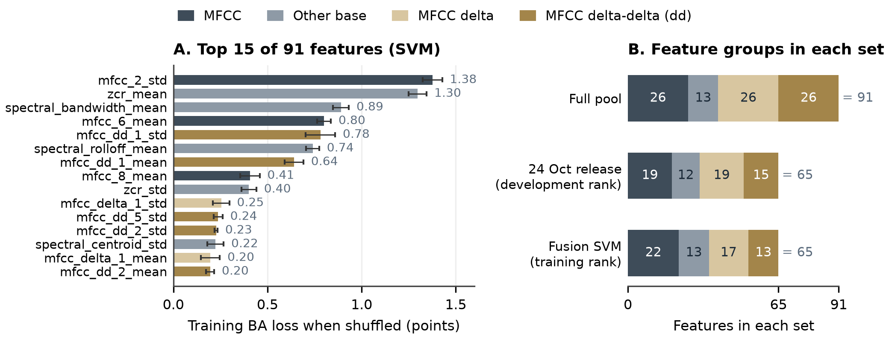

**Figure 6.** A: permutation importance of the full 91 SVM on 27,797 training clips. Error bars give one standard deviation of five shuffles. B: feature groups in the full pool and in the two 65-feature sets.

**Table 9. E1 results before calibration**

| Classifier and features | Validation BA | Test BA |
| --- | ---: | ---: |
| LR, all 91 (selected) | 93.82% | 93.61% |
| RF, 80 of 91 (selected) | 93.44% | 94.19% |
| SVM, base 39 | 95.62% | 95.30% |
| SVM, all 91 | 96.81% | 96.53% |
| SVM, 65 of 91, development rank (24 October release) | 97.12% | 96.69% |
| SVM, 65 of 91, training rank (Acoustic SVM) | 97.12% | 96.56% |

> **ANSWER** The RBF SVM gives the highest BA. MFCC delta features add 1.23 test points to the SVM. With 65 features, the SVM keeps its validation BA (97.12% against 96.81%) and uses 28.6% fewer inputs. mfcc_2_std and zcr_mean have the largest effect: 1.38 and 1.30 points.

> **DECISION** Use the RBF SVM with 65 of 91 features as Acoustic SVM. Use the training-only ranking in all matched comparisons.

> **LIMIT** Correlated features share importance. The ranking shows what the model uses, not the cause of an accent difference. The 24 October ranking uses development data, which include validation labels. The two 65-feature sets share 59 features [5].

<!-- pagebreak -->

## 5 E2 Transfer learning with frozen Whisper

> **QUESTION** Do frozen Whisper features classify accent better than acoustic features? Does PCA to 32 components lose information?

Whisper SVM uses the frozen `base.en` encoder at revision `911407f`. It averages the encoder frames of real audio and ignores padding frames. This gives 512 values for each clip. Only the scaler and the SVM learn from the data [6].

**Table 10. E2 test setup**

| Item | Setting |
| --- | --- |
| Prepared data | 40,000 clips; the same prepared waveforms for all three models (Section 3). |
| Speaker split | 27,797 training; 6,084 validation; 6,119 test clips. No speaker appears in two partitions. |
| Test composition | 3,034 Singapore and 3,085 non-Singapore clips from 1,482 speakers. |
| Feature pipelines | Acoustic: scale 65 training-ranked features. Whisper: scale 512 values. PCA32: scale 512 values → PCA32 → scale components. |
| SVM | RBF kernel; gamma = scale; balanced class weights; seed 42. |
| C selection | Try 0.01, 0.1, 1, and 10 on training data. Choose validation BA, then macro F1, then the smaller C. |
| Final fitting | Refit the scaler, optional PCA, and SVM on 33,881 training plus validation clips. The encoder stays frozen. |
| Test rule | An uncalibrated SVM score ≥ 0 predicts Singapore. No fitting or threshold selection uses test data. |
| 95% intervals | 2,000 paired resamples of whole test speakers within each class; seed 42. |

**Table 11. E2 results on the same 6,119 test clips before calibration**

| Model | SVM features | Selected C | Test BA | Errors |
| --- | ---: | ---: | ---: | ---: |
| Acoustic SVM | 65 | 1 | 96.56% | 211 |
| Whisper PCA32 SVM | 32 | 1 | 95.43% | 280 |
| Whisper SVM | 512 | 10 | 98.73% | 78 |

> **ANSWER** Yes. Whisper SVM is 2.16 points [1.35, 3.01] above Acoustic SVM and makes 133 fewer errors. Whisper PCA32 SVM is 3.30 points [2.54, 4.17] below Whisper SVM and makes 202 more errors. PCA32 therefore loses useful classification information and falls below Acoustic SVM on this test.

> **DECISION** Use Whisper SVM as the main single-model control. Do not use PCA32 Whisper features alone.

<!-- pagebreak -->

## 6 E3 Unsupervised learning

> **QUESTION** Do Whisper features form accent groups when no labels are used?

E3 uses 33,881 development clips from 8,443 speakers. It uses no test clip. Standard scaling and PCA keep 50 components (59.68% of the variance). K-means then fits two clusters with ten starts and seed 42. Accent and source labels are added after the fit [7].

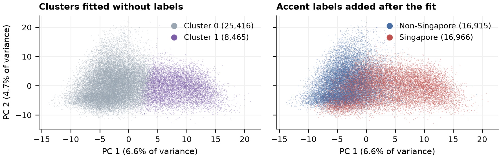

**Figure 7.** The same PCA coordinates, colored by cluster (left) and by accent label (right). K-means uses all 50 components. The plot shows the first two.

**Table 12. Cluster checks**

| Check | Result | Meaning |
| --- | ---: | --- |
| Adjusted Rand index (ARI) with accent labels | 0.182 | Weak agreement. 0 is chance; 1 is the same grouping. |
| Silhouette (5,000 clips) | 0.127 | The clusters overlap. |
| Singapore share of cluster 1 | 92.83% | Cluster 1 holds only 46.3% of the Singapore clips. |
| ARI with one mean for each speaker | −0.061 | The agreement disappears at speaker level. |
| Speakers with clips in both clusters | 1,135 | A cluster is not a stable speaker property. |

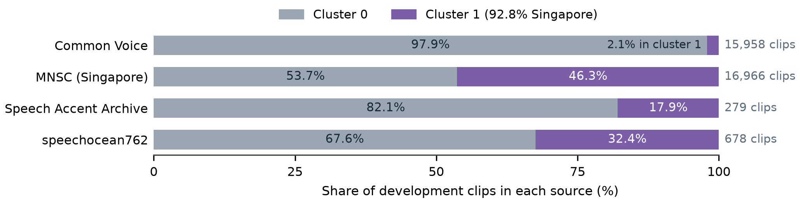

**Figure 8.** Cluster share in each source. Source names were added after the fit.

> **ANSWER** Only weakly. Cluster 1 is 92.8% Singapore but holds only 46.3% of the Singapore clips. Common Voice puts 97.9% of its clips in cluster 0. Each source has one class, so source and accent effects stay mixed.

> **DECISION** Use E3 as analysis only. Do not use the clusters as labels or as a classifier. E3 does not change the supervised models.

<!-- pagebreak -->

## 7 E4 Hybrid model: feature fusion

> **QUESTION** Does a hybrid of acoustic and Whisper features beat the best single model?

### 7.1 Why feature fusion instead of voting

**Table 13. Voting and feature fusion**

| Item | Weighted voting (proposal) | Feature fusion (used) |
| --- | --- | --- |
| How it joins | P = w1 × P(acoustic) + w2 × P(Whisper) | Joins the two feature blocks before one SVM |
| Models to fit and calibrate | Two models and one weight | One model |
| Pilot result on 400 clips | 98.00% BA, 8 errors | 98.00% BA, 8 errors |

The pilot shows no difference. Fusion needs one model and one calibration step, so the full study uses fusion. The pilot does not show that fusion is better than voting.

### 7.2 Fusion pipeline

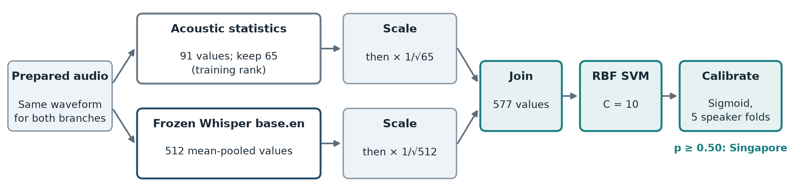

**Figure 9.** Fusion SVM. Scale each block and multiply it by 1/√(block size). This gives each block a similar effect on the RBF kernel. No PCA.

Fusion SVM and Whisper SVM use the same encoder, split, development data, C = 10, and five calibration folds. The acoustic block uses the training-only ranking from E1 [8].

### 7.3 Matched comparison

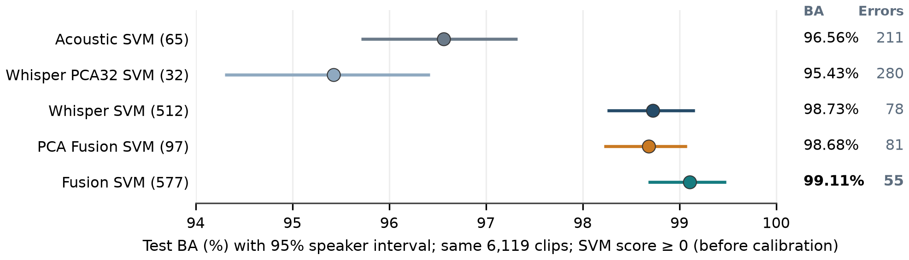

**Figure 10.** All models on the same 6,119 test clips before calibration (SVM score ≥ 0). The number after each name is the SVM feature count.

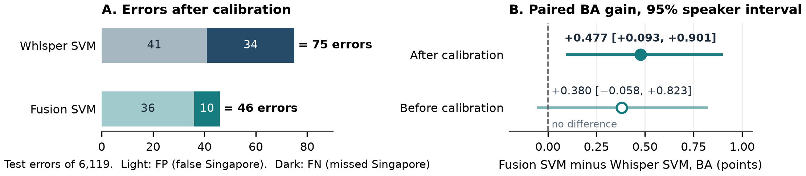

**Figure 11.** A: errors after calibration at p ≥ 0.50. B: paired BA gain of Fusion SVM over Whisper SVM. The dashed line is no difference.

**Table 14. Calibrated comparison on the same 6,119 test clips at p ≥ 0.50**

| Model | BA [95% interval] | Macro F1 | FP | FN | Errors |
| --- | --- | ---: | ---: | ---: | ---: |
| Whisper SVM | 98.775% [98.304, 99.186] | 0.9877 | 41 | 34 | 75 |
| Fusion SVM | 99.252% [98.940, 99.536] | 0.9925 | 36 | 10 | 46 |

The two models disagree on 81 clips. Fusion SVM is correct on 55 and Whisper SVM on 26. Thus fusion removes 29 errors (38.7%). Most of the gain is on MNSC: missed Singapore clips decrease from 34 to 10.

> **ANSWER** Yes, after calibration. Fusion SVM gains 0.477 points [0.093, 0.901] over Whisper SVM. Before calibration, the gain is 0.380 points [−0.058, 0.823], and the interval includes zero.

> **DECISION** Use Fusion SVM as the report model. Keep Whisper SVM as the single-model control.

> **LIMIT** The gain applies to these fitted models on a retrospective test. There is no adjustment for the many model comparisons.

## 8 Calibration and errors

> **QUESTION** Does Fusion SVM give usable probabilities, and where does it make errors?

A sigmoid changes SVM scores into probabilities. It learns from scores on development speakers that each fold model did not see. The final SVM then fits all development clips. The threshold stays at p ≥ 0.50 [8].

**Table 15. Effect of calibration on the same 6,119 test clips**

| Measure | Whisper SVM | Fusion SVM |
| --- | ---: | ---: |
| Errors before calibration (FP / FN) | 78 (45 / 33) | 55 (47 / 8) |
| Errors after calibration (FP / FN) | 75 (41 / 34) | 46 (36 / 10) |
| BA after calibration | 98.775% | 99.252% |
| Brier score (lower is better) | 0.0096 | 0.0057 |
| Log loss (lower is better) | 0.0361 | 0.0204 |

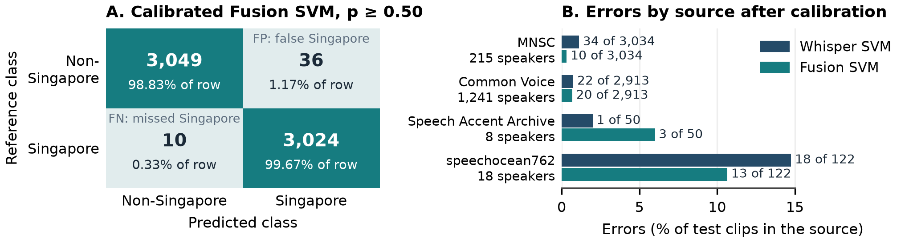

**Figure 12.** A: confusion matrix of the calibrated Fusion SVM. Percentages use each reference class. B: errors in each test source after calibration.

Singapore precision is 98.82% and recall is 99.67%. Non-Singapore precision is 99.67% and recall is 98.83%. Both F1 values are 0.9925.

> **ANSWER** Yes, on this test. Calibration removes 9 Fusion SVM errors. Fusion SVM has a lower Brier score and log loss than Whisper SVM. Most remaining errors are false Singapore labels: 36 of 46.

> **LIMIT** speechocean762 and Speech Accent Archive have only 18 and 8 test speakers. Do not rank models on these sources. The probability losses have no paired interval. Thus they do not show reliable calibration for each source, device, or speaker group.

## 9 Compression and classifier cost

> **QUESTION** Does PCA compression give a better balance of accuracy and cost?

The comparison keeps the encoder, the 65 acoustic columns, the split, the development data, and C = 10. Both pipelines use the SVM score rule before calibration [9].

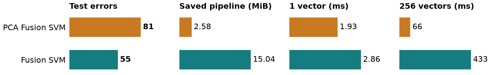

**Figure 13.** PCA Fusion SVM against Fusion SVM. Lower is better in each panel. Times are medians for prepared feature vectors on one host. They do not include the encoder.

**Table 16. Compression comparison on the same 6,119 test clips before calibration**

| Measure | PCA Fusion SVM | Fusion SVM |
| --- | ---: | ---: |
| SVM features | 97 | 577 |
| BA | 98.682% | 99.106% |
| FP / FN | 62 / 19 | 47 / 8 |
| Support vectors | 3,463 | 3,538 |

Compression removes 83.2% of the SVM features and makes the saved pipeline 82.8% smaller. It adds 26 errors and loses 0.424 points [0.187, 0.684]. PCA keeps 50.0% of the Whisper variance.

**Table 17. Cost of the calibrated models for one prepared feature vector**

| Measure | Whisper SVM | Fusion SVM |
| --- | ---: | ---: |
| Median / 95th percentile time | 4.12 / 6.40 ms | 4.06 / 6.63 ms |
| Saved model size | 12.13 MiB | 15.28 MiB |
| Support vectors | 5,370 | 3,538 |

Each model has 60 timed single requests, after warm-up, in alternate order. Both medians are approximately 4 ms, so the samples show no speed difference.

> **ANSWER** No, when accuracy is the priority. Compression saves classifier time and size but adds 26 errors. Whisper still computes 512 values before PCA, so compression does not decrease encoder work.

> **DECISION** Keep Fusion SVM. Use PCA Fusion SVM only if the application accepts its accuracy loss.

> **LIMIT** The costs do not include the encoder, audio preparation, feature extraction, model loading, network, or concurrent requests. Full service latency and memory are not measured.

## 10. Performance Test

> **QUESTION** Does Fusion SVM give the best result on new clips from speakers not used for fitting?

The test has 9,000 clips from 1,950 speakers: 3,000 MNSC PART1, 3,000 MNSC PART2, and 3,000 Common Voice clips [10].

Checks found no recordings from the 40,000-clip study or the previous 9,000-clip test. No speaker was used in training or validation. All four saved models use the same prepared audio and p ≥ 0.50. No model or threshold was changed.

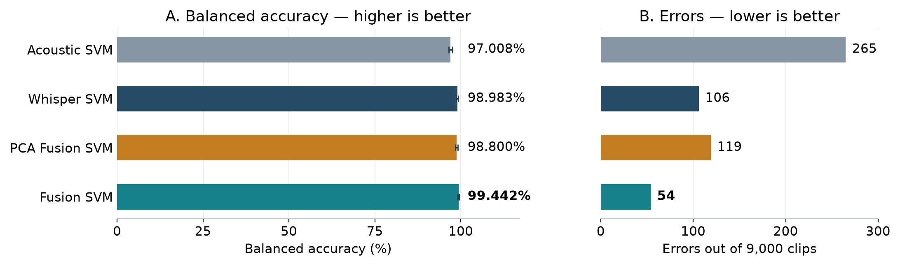

**Figure 14.** A: test BA; higher is better. B: total errors; lower is better. Lines show 95% BA intervals from 2,000 resamples of whole speakers.

**Table 18. Results on the same 9,000 clips. Each source has 3,000 clips.**

| Model | BA | PART1 errors | PART2 errors | Common Voice errors | Total errors |
| --- | ---: | ---: | ---: | ---: | ---: |
| Acoustic SVM | 97.008% | 96 | 75 | 94 | 265 |
| Whisper SVM | 98.983% | 76 | 14 | 16 | 106 |
| PCA Fusion SVM | 98.800% | 70 | 24 | 25 | 119 |
| **Fusion SVM** | **99.442%** | **34** | **7** | **13** | **54** |

> **ANSWER** Yes. Fusion SVM has the fewest errors in each source. It makes 52 fewer errors than Whisper SVM. Its BA gain is 0.458 points [0.236, 0.688].

> **LIMIT** All MNSC speakers and 277 Common Voice speakers also occur in the original test. Thus this test is not independent of earlier tests. Source and class remain linked. The intervals exclude fitting and selection uncertainty.

Acoustic SVM and PCA Fusion SVM use the 24 October fits. Whisper SVM and Fusion SVM use the 29 October fits. The two fusion models use different acoustic columns. Thus this table does not measure the effect of PCA alone.

<!-- pagebreak -->

## 11 Results against the proposal

> **QUESTION** Does the work meet the proposal requirements and success criteria?

**Table 19. Proposal requirements and evidence**

| Requirement | Evidence | Section | Status |
| --- | --- | :---: | --- |
| Supervised learning | LR, SVM, and RF on labelled speaker partitions | 2, 4 | Met |
| Machine learning and deep learning | Acoustic SVM against an SVM on frozen Whisper features | 4, 5 | Met (transfer learning) |
| Unsupervised learning | PCA and K-means without labels; 2D plot and overlap check | 6 | Met; clusters are not accent classes |
| Hybrid method | Voting in the pilot; feature fusion in the full study | 2, 7 | Met; design changed |
| BA, precision, recall, F1, confusion matrix | Tables 14 and 15; Figure 12 | 7, 8 | Met |
| Hybrid improves or keeps F1 | Macro F1 0.9925 against 0.9877; interval of the gain above zero | 7 | Met on this test |
| More stable probabilities | Lower Brier score and log loss | 8 | Measured; no population claim |
| Speaker split near 70/15/15 | No shared speakers; 69.9/15.2/14.9% | 3 | Met |
| Same preparation for all corpora | One preparation for all clips | 3 | Met |

**Table 20. Limits and next steps**

| Limit | Effect | Next step |
| --- | --- | --- |
| Source and class are linked | A score can use recording cues | Add Singapore English from a second source |
| Repeated use of the test | The test is not untouched | Keep new speakers and sources for a final test |
| Intervals exclude selection noise | Intervals are too narrow | Use nested speaker folds for feature count and C |
| Small sources (8 and 18 test speakers) | Wide uncertainty | Add speakers before source claims |
| No language check for this fit | Non-English input can get a Singapore label | Repeat the 28-clip rejection check |

**Table 21. Readiness of Fusion SVM**

| Check | Status | Next action |
| --- | --- | --- |
| Saved-model replay | Passed | Saved classes and probabilities reproduce. |
| Study and additional-audio tests | Complete | Use within the overlap and source limits. |
| Full service performance | Pending | Measure latency, memory, concurrent requests, and live devices on the target host. |
| Fine-tuned Whisper Small fusion | Not compared | Complete the training and selection records first [13]. |

> **DECISION** Report Fusion SVM.

<!-- pagebreak -->

## Appendix A Study changes and data growth

**Table 22. Changes from the proposal**

| Item | Proposal | Implemented, and reason |
| --- | --- | --- |
| Data size | About 200 speakers; 2,000 to 3,000 clips | 9,925 speakers and 40,000 clips, for wider speaker coverage |
| Non-Singapore class | Five native-English accent groups in Common Voice | Eight accent groups in three sources, including Asian English accents |
| Hybrid method | Weighted probability voting | Feature fusion, after equal pilot BA |
| Transcription | The accent result selects vocabulary prompts | Separate fine-tuned Whisper Small; outside this chapter |

**Table 23. More data did not show a BA gain. Each row uses the test clips that both models share.**

| Data change | Model | Shared test clips | Earlier BA | Later BA |
| --- | --- | ---: | ---: | ---: |
| 11,486 to 40,000 | Acoustic SVM, 91 features | 1,634 | 94.46% | 93.31% |
| 11,486 to 40,000 | Selected acoustic SVM | 1,634 | 94.35% | 93.86% |
| 11,486 to 40,000 | Historical PCA fusion | 1,634 | 97.41% | 97.00% |
| 30,000 to 40,000 | Selected acoustic SVM | 4,500 | 96.24% | 96.24% |
| 30,000 to 40,000 | Historical PCA fusion | 4,500 | 98.47% | 98.49% |

The 11,486 rows use 668 test speakers. The 30,000 rows use 1,285. Do not compare BA levels between the two test sets. For 30,000 to 40,000, both change intervals include zero. They are −0.40 to 0.40 acoustic points and −0.20 to 0.26 fusion points [12].

The expansion also removes 672 Malaysian clips and changes the acoustic selection from 35 to 65 features. Thus these runs do not isolate data size. We keep the larger data for speaker coverage, not for a BA gain.

<!-- pagebreak -->

## Evidence sources

Links are relative to this report. The records keep the settings, saved predictions, and file checks.

1. **Project proposal.** [Singlish draft](../../tmp/docs/Singlish_draft.md).
2. **Data and partitions.** [Dataset guide](../../accent_classifier_data/README.md) and [split manifest](../../accent_classifier_data/manifests/dataset_40000.json).
3. **Pilot.** [Pilot study report](Pilot_Test/Pilot_Test_Report.md). Ten supervised systems on the matched 2,000-clip split.
4. **Acoustic models.** [E1 feature study](../E1_Feature_Engineering_20261024/E1_feature_engineering_results_report_20261024.md). Full feature sets, selected counts, and speaker-fold checks.
5. **Training-only acoustic selection.** [Controlled ranking report](E1_Feature_Engineering_20261028/evidence/context/A1/report.md). Notebook `E4_02_1_tuned_acoustic_svm_whisper_and_fusion.ipynb`.
6. **Whisper controls.** [Frozen Whisper study](Classification_Tests_20261028/E2_Whisper_Only_20261028/report.md). Full and PCA features, SVM search, and predictions.
7. **Unsupervised analysis.** [Development-only cluster study](Classification_Tests_20261028/E3_Clustering_20261028/report.md). Assignments, source checks, and the speaker-mean check.
8. **Primary fusion comparison.** [Matched calibrated report](E1_Feature_Engineering_20261028/A2_Full512_vs_Fusion_20261029/report.md). Notebook `E4_02_5_frozen_full512_vs_fusion_calibrated.ipynb`; model contracts, calibration folds, predictions, paired intervals, and times.
9. **Compression comparison.** [PCA comparison record](E1_Feature_Engineering_20261028/PCA32_Compression_Comparison_20261029/README.md). Same acoustic columns and score rule; saved-model replay and classifier costs.
10. **Performance test.** [New 9,000-clip test](Performance_Test_Unseen_9000_20261029/Performance_Test_Report.md). Four saved models, new recordings, no training or validation speakers, and verified overlap checks.
11. **Audio preparation check.** [24 October performance report](../Perfomance_Test_20261024/Performance_Test_Report.md). Raw and prepared PART2 comparison.
12. **Historical data comparisons.** [Experiment review](Classification_Tests_20261028/E1_Historical_Experiment_Review_20261028.md). Shared test clips and data-growth limits.
13. **Other fusion studies.** [28 October review](E1_Feature_Engineering_20261028/Fusion_Replacement_Review.md) and [notebook archive](E1_Feature_Engineering_20261028/notebooks/). Frozen and fine-tuned Whisper Small studies use different features and fits.

### Saved model identification

Fusion SVM is the 29 October `E4_02_5` fit. It uses training-only acoustic ranking, 577 SVM features, and C = 10. Whisper SVM is its matched 512-feature control. Both use sigmoid calibration with the same five speaker folds.

The compression study uses the training-ranked PCA pipeline from `E4_02_1` and the uncalibrated Fusion SVM from `E4_02_5`. Acoustic SVM and PCA Fusion SVM in Table 18 use the 24 October development-ranked models. Do not share scores between saved fits only because they have the same feature count.
